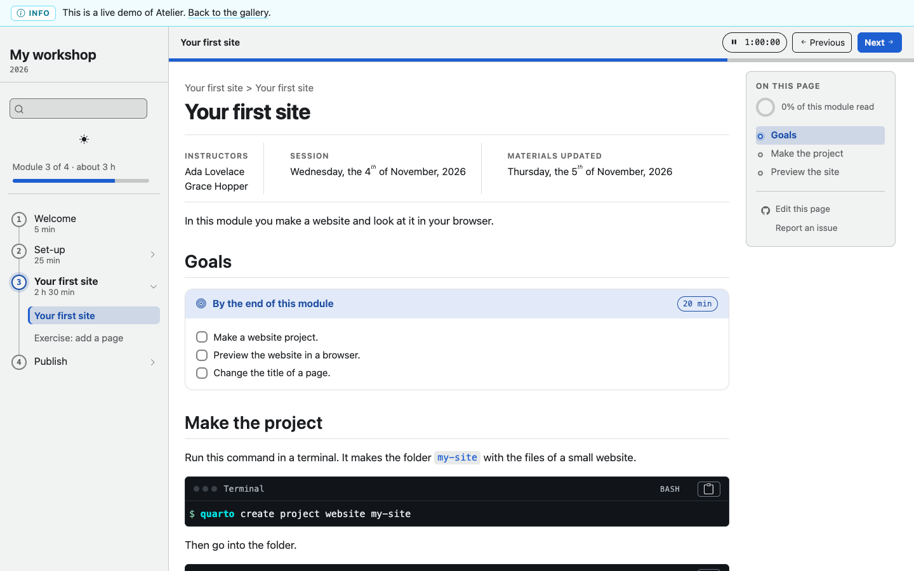
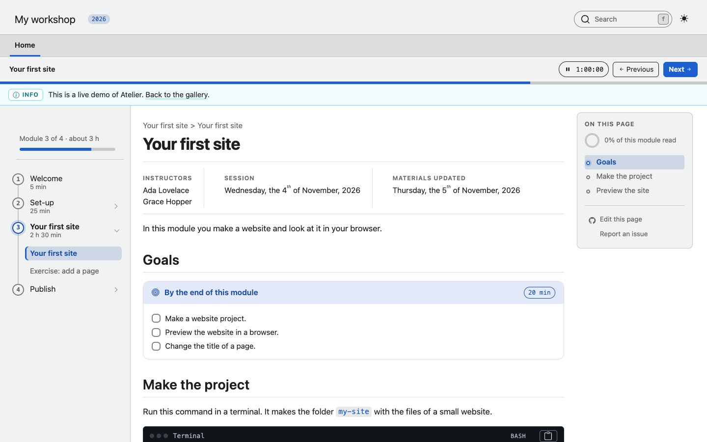
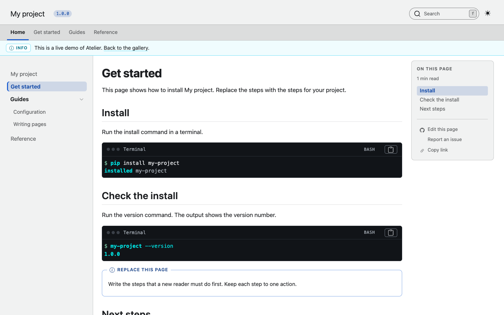
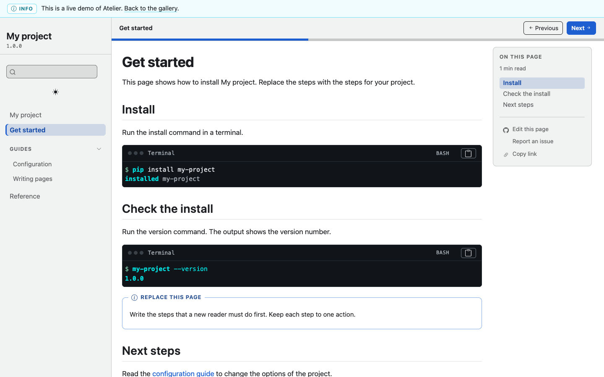

::: {layout-ncol=2}
[{width="1440" height="900" loading="lazy" fig-alt="A workshop page with a sidebar of numbered modules and durations, a timer and Previous and Next buttons in a top bar, and a table of contents on the right, in the light colour scheme."}](demos/workshop-sidebar/index.html)

[{width="1440" height="900" loading="lazy" fig-alt="A workshop page with a navbar and a search button on top, then the module sidebar, the timer bar, and the page content, in the light colour scheme."}](demos/workshop-navbar/index.html)

[{width="1440" height="900" loading="lazy" fig-alt="A documentation page with a navbar of top-level links, a docked sidebar of pages, the page content, and a table of contents on the right, in the light colour scheme."}](demos/docs-navbar/index.html)

[{width="1440" height="900" loading="lazy" fig-alt="A documentation page with no navbar, a docked sidebar with a search field and grouped pages, the page content, and a table of contents on the right, in the light colour scheme."}](demos/docs-sidebar/index.html)
:::
