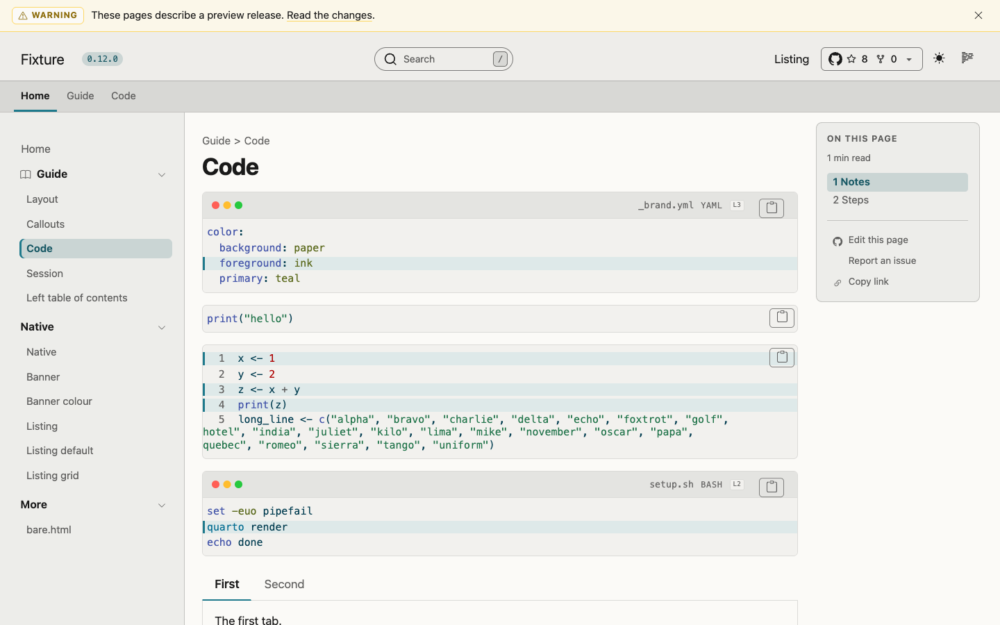
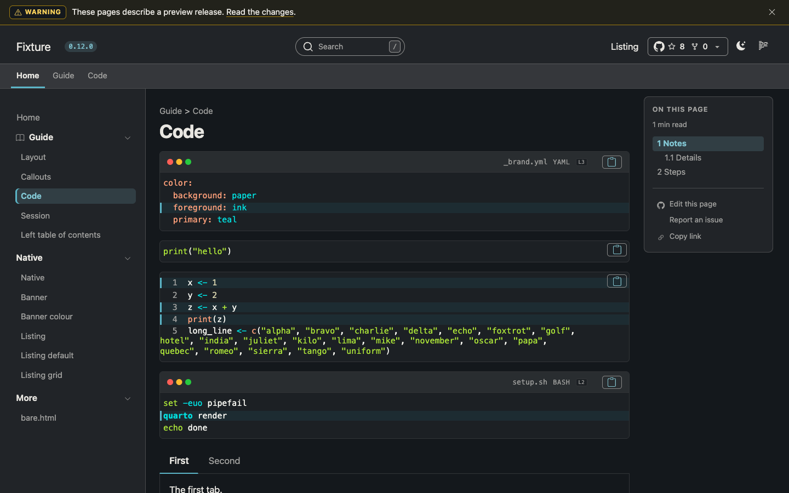
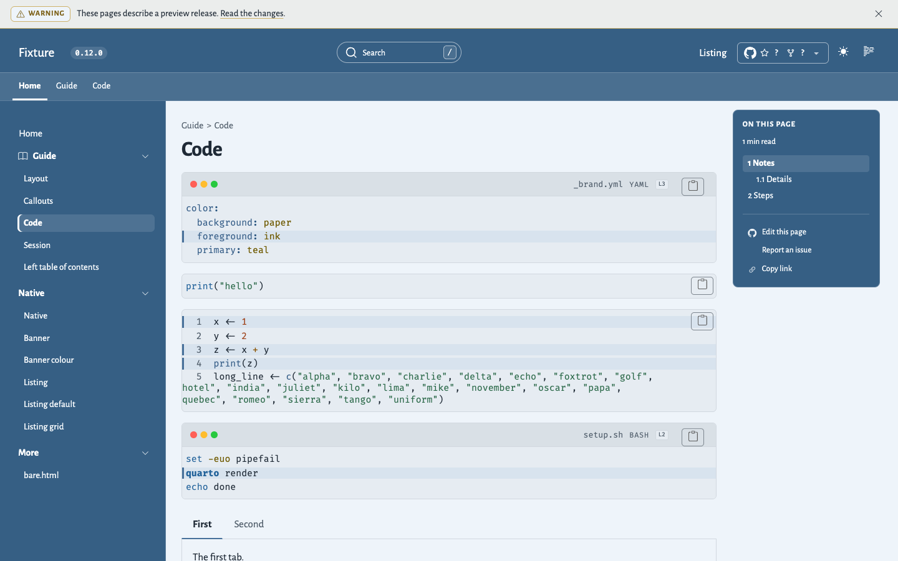
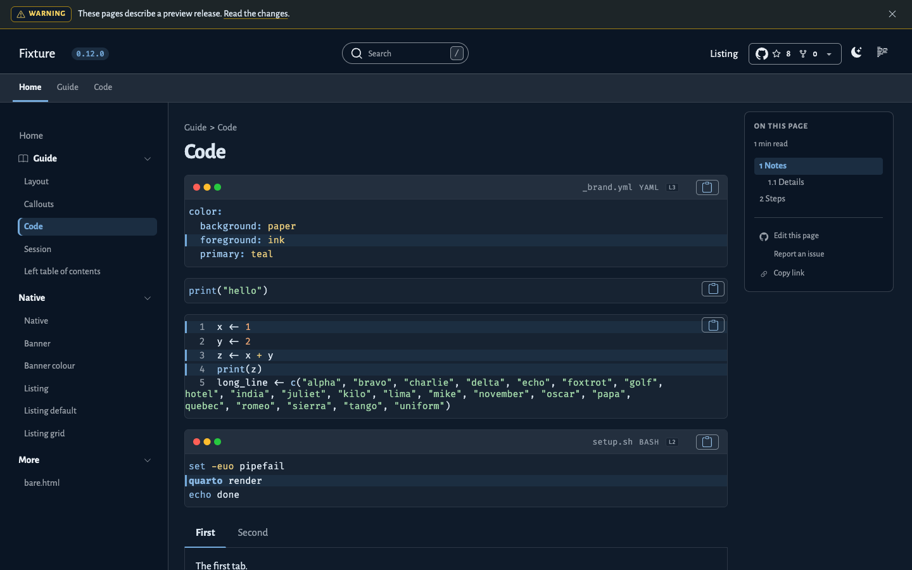
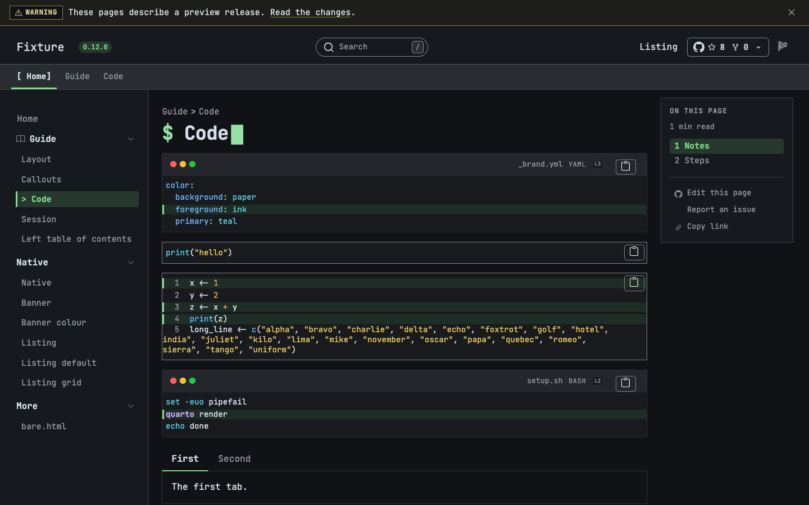

Atelier takes the colours and the fonts of the site from `_brand.yml`.
It calculates the colours of the navbar, the sidebar, the bars, and the cards from the brand, for each colour scheme.

## Brand keys

| Key | What Atelier does with it |
| --- | ------------------------- |
| `color.background` | The page background. Atelier mixes it with the foreground for the bars, the sidebar, and the surfaces. |
| `color.foreground` | The text and the borders. It also gives the ink of the bars and of the exercise header. |
| `color.primary` | The accent: the current item, the tabs, the progress fill, the focus ring, and the accent of the gitlink widget. Atelier holds it to the contrast below. |
| `color.secondary` | The muted text, when the brand sets it, held to 4.5:1. When the brand does not set it, Atelier mixes the muted text from the foreground and the background. |
| `color.tertiary` | Not used. Quarto makes it a text colour, so it cannot fill a surface. |
| `color.palette.blue`, `green`, `yellow`, `orange`, `red` | The callout colours. See [Callout colours](#callout-colours). |
| `color.success`, `info`, `warning`, `danger`, `light`, `dark` | Bootstrap components only. |
| A colour with `light` and `dark` values | Each colour scheme calculates its own chrome from its own value. |
| `typography` | Quarto applies the fonts to the theme, and Atelier does not change them. The chrome sizes are in `rem`, so they follow the base font size. |
| `typography.link` | The content links. When it gives no colour, the links take `color.primary`, held to 4.5:1. The links of the chrome keep their own colours. |
| `logo.small`, `medium`, `large` (with `light`, `dark`, and `alt`) | Quarto chooses the logo of the navbar and of the sidebar. When there is no logo, the site title shows. |
| `meta` | Not used. |
| `defaults.bootstrap.defaults` | Sets a Bootstrap variable or an `$atelier-*` variable. |
| `defaults.bootstrap.uses`, `functions`, `mixins`, `rules` | Your own rules. The Atelier selectors are flat, so your rules can override them. |

: How Atelier uses each key of `_brand.yml`. {.striped .hover tbl-colwidths="[30,70]"}

## Presets

A preset sets a complete look: the colours, the fonts, and the syntax highlighting.
Atelier has three presets: `default`, `quarto`, and `terminal`.
To choose one, set `atelier-preset` in `_brand.yml`:

```{.yaml filename="_brand.yml"}
defaults:
  bootstrap:
    defaults:
      atelier-preset: quarto
```

The default is `default`.
Any other value stops the build, and the error names the three presets.

Every value of a preset is a default.
A `color` key, a `typography` key, or a `defaults.bootstrap.defaults` value in your `_brand.yml` wins over the preset.
The preset fills in only what the brand leaves out.

### The default preset

This is the Atelier look.
It takes its colours and fonts from your `_brand.yml`, and it has a light and a dark colour scheme.

| Light | Dark |
| --- | --- |
|  |  |

: The default preset. {tbl-colwidths="[50,50]"}

### The quarto preset

This preset is close to the look of the Quarto website.
It has a light and a dark colour scheme, and it sets only a palette and two typefaces.

- The page is `#f8fafc` in light and `#161b22` in dark.
- The primary colour is `#47709a` in light and `#74aadb` in dark.
  In light, the accent of the chrome is `#355372`, a darker step that keeps the contrast.
- The body and the headings use Alegreya Sans.
  The code uses Fira Code.

| Light | Dark |
| --- | --- |
|  |  |

: The quarto preset. {tbl-colwidths="[50,50]"}

### The terminal preset

This preset is a modern dark terminal.
It is pinned to the dark colour scheme.
The stylesheet hides the colour scheme toggle, and a script switches the page to the dark scheme.
The preset stays dark, and the reader cannot change it.

- The font is JetBrains Mono everywhere, and the corners are square.
- The title shows a prompt and a cursor.
  The cursor stops blinking within 5 seconds, and it does not blink if the reader asks for reduced motion.
- Second-level and third-level headings have the prefix `##` and `###`.
- List items use `-` as the marker.
- The current sidebar item has the marker `>`, and the current navbar link has brackets around it.
- The rules under headings and the borders of callouts are dashed.
  Code blocks have a solid border.
- Links have a dotted underline.



To turn the decoration off, set `atelier-terminal-decoration` to `false`.
This setting has no effect on the other presets.

```{.yaml filename="_brand.yml"}
defaults:
  bootstrap:
    defaults:
      atelier-preset: terminal
      atelier-terminal-decoration: false
```

### Fonts

The fonts are part of the extension, in `_extensions/mcanouil/atelier/fonts/` of your site.
The pages do not make a request to Google or to any other third party.
The fonts are Alegreya Sans, Fira Code, and JetBrains Mono.
Each one is under the SIL Open Font License, and the licence text is next to the font files.

### Syntax highlighting

Each preset has a highlighting theme for each colour scheme.
The six `.theme` files are in `_extensions/mcanouil/atelier/highlighting/` of your site, and they are named `atelier-<preset>-<light|dark>.theme`.
Each file gives a colour and a style for the 31 token types.

Atelier holds each token colour to WCAG AA (4.5:1) on the code surface.
It does this when the format uses the default `arrow` theme, or one of the Atelier themes.
For any other theme, Atelier changes nothing, so that theme keeps its own colours.

To use a theme in another format, point `syntax-highlighting` at the file.
The path below is for an extension that you install with `quarto add`:

```{.yaml filename="_quarto.yml"}
format:
  html:
    syntax-highlighting:
      light: _extensions/mcanouil/atelier/highlighting/atelier-quarto-light.theme
      dark: _extensions/mcanouil/atelier/highlighting/atelier-quarto-dark.theme
```

The script `scripts/generate-highlighting.py` in the repository writes `html/highlighting-tokens.scss` from the `.theme` files.
Run it with `--check` to find a difference between the two.

## Contrast

Atelier targets WCAG 2.2 AA in both colour schemes, for each brand.

- Text has a contrast of 4.5:1 or more against its background.
- Borders of controls, the progress fill, and the focus ring have a contrast of 3:1 or more.

Atelier moves a brand colour towards black or white until it has this contrast.
A colour that already has the contrast does not change.
A variable that you set yourself is used as you write it, with no correction.
Atelier still corrects the colours that it derives from that value, which are the accent mark and the accent fill.

## Dark scheme without dark colours

A page can have no `_brand.yml`, or a brand that gives light colours only.
In the dark scheme, such a page uses fixed dark colours of Atelier for its background and its text.
The `$atelier-chrome-dark-*` variables do not change these colours.
The brand accent stays, and Atelier moves it until it has a contrast of 4.5:1 on the dark background.
When the brand gives no accent, the page uses the dark accent of Atelier.
In this case, Atelier replaces `$body-bg`, `$body-color`, and `$pre-color`, and moves `$primary` and `$link-color` to 4.5:1, even when you set these variables yourself.

## Chrome palette

The chrome is the navbar, the sidebar, the bars above the page, the table of contents card, and the footer.
`$atelier-chrome` sets how the chrome follows the colour scheme:

| Value  | Effect                                                                                  |
| ------ | --------------------------------------------------------------------------------------- |
| `auto` | The default. The chrome comes from the brand, and it follows the colour scheme.         |
| `light` | The chrome uses the light palette in both colour schemes.                               |
| `dark` | The chrome uses the dark palette in both colour schemes.                                |

: Values of `$atelier-chrome`. {.striped .hover tbl-colwidths="[16,84]"}

| Variable                                                                    | Effect                                                                |
| --------------------------------------------------------------------------- | --------------------------------------------------------------------- |
| `$atelier-chrome-light-bg`, `$atelier-chrome-light-fg`, `$atelier-chrome-light-accent` | The light palette, for `$atelier-chrome: light`.                      |
| `$atelier-chrome-dark-bg`, `$atelier-chrome-dark-fg`, `$atelier-chrome-dark-accent` | The dark palette, for `$atelier-chrome: dark`.                        |
| `$atelier-chrome-bg`, `$atelier-chrome-fg`                                  | The background and the text of the chrome.                            |
| `$atelier-chrome-accent`                                                    | The accent of the chrome: the current item, the tabs, and the marks.  |
| `$atelier-chrome-muted`                                                     | The muted text of the chrome.                                         |
| `$atelier-chrome-surface`                                                   | The surface of menus and of the tab row.                              |
| `$atelier-chrome-border`, `$atelier-chrome-control-border`                  | The lines between surfaces, and the borders of controls.              |

: Sass variables of the chrome palette. {.striped .hover tbl-colwidths="[46,54]"}

Atelier calculates the other chrome colours from the background, the text, and the accent.
Thus, to change the chrome, you usually set those three only.

You can set the variables in two places.
In `_brand.yml`, use `defaults.bootstrap.defaults`, with the name of the variable and no `$`:

```{.yaml filename="_brand.yml"}
defaults:
  bootstrap:
    defaults:
      atelier-chrome: dark
      atelier-chrome-accent: "#E0A030"
```

In a project stylesheet, set them in the `defaults` layer, and list the file in `format.atelier-html.theme`:

```{.scss filename="assets/stylesheets/theme.scss"}
/*-- scss:defaults --*/
$atelier-chrome: light;
$atelier-chrome-light-accent: #1f5f80;
```

## Callout colours

Each callout type takes a palette colour of the brand:

| Callout          | Palette colour |
| ---------------- | -------------- |
| `callout-note`      | `blue`         |
| `callout-tip`       | `green`        |
| `callout-warning`   | `yellow`       |
| `callout-caution`   | `orange`       |
| `callout-important` | `red`          |

: The palette colour of each callout type. {.striped .hover tbl-colwidths="[50,50]"}

Atelier uses these names for each brand.
Quarto alone uses them only when the brand also has `defaults.bootstrap`.
The same names also give the Bootstrap colours that come from them, such as `danger` from `red`.

## Terminal block

The [terminal block](workshop.qmd#terminal) is dark in both colour schemes.
Its colours are fixed, and they do not come from the brand.
To change them, set the `$atelier-terminal-*` variables, such as `$atelier-terminal-bg`.
Each text colour has a contrast of 4.5:1 or more on the dark background.
