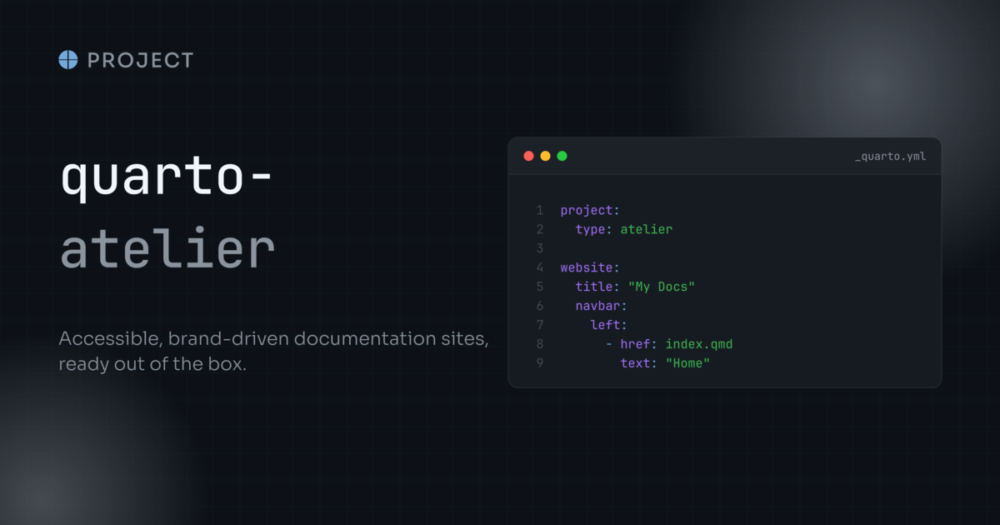
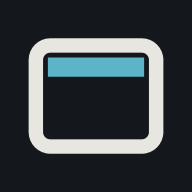

Set `project.type: atelier` in your `_quarto.yml`, provide a `_brand.yml`, then author pages as usual.
The sections below exercise the elements the project type styles for dark mode and accessibility; toggle the colour scheme while scrolling to see each one hold up.

## Announcement banner

The banner at the top of the page is pinned to a light tint of its alert type with a contrast-picked ink, so it reads the same in both schemes.
Configure it as usual under `website.announcement`; without one, the rules are inert.

## Code

Inline `code`, a highlighted block:

```bash
quarto add 
```

and a plain block with no language:

```text
no language, still framed and styled
```

Hover a block: the copy button takes the palette accent instead of Quarto's fixed grey, in both schemes.

A block with a `filename` shows in a code window, which takes its surfaces from the theme:

```{.yaml filename="_quarto.yml"}
project:
  type: atelier
```

A collapsible window with a plain block in it:

```{.text filename="notes.txt" code-window-collapse="open"}
no language, inside a collapsible window
```

Code in a callout keeps the same inset as code on the page:

::: {.callout-note}

## In a callout

```bash
quarto preview
```

:::

Annotated code keeps its rows flush with the annotation markers:

```bash
quarto render # <1>
```

1. Render the whole project.

Annotated code in a code window:

```{.bash filename="publish.sh"}
quarto publish gh-pages # <1>
```

1. Publish the site to GitHub Pages.

## Syntax highlighting

These blocks hold every token type that Pandoc marks, so each colour of the highlighting theme shows on the code surface:

```cpp
//BEGIN scale
#include <cstdio>

/// Scale a value.
/** @param x The input. @note Pure. @warning No bounds check. */
template <typename T>
T scale(T x) {
  const char tab = '\t';
  const float k = 1.5f;
  unsigned mask = 0x1F;
  int bad = 08;
  // TODO: clamp the result.
  if (x > 0) {
    std::printf("%d\n", mask);
    return x * k;
  }
  return 0;
}
//END
```

```r
#' Scale a vector.
#' @param x A numeric vector.
scale_by <- function(x, k = 2L) {
  stopifnot(is.numeric(x), !is.null(NULL), TRUE)
  x * k
}
```

```python
import re

pattern = re.compile(r"\d+")
label = f"{pattern.pattern} matches"
```

```php
<?php
/** @var int $length */
$length = strlen("atelier");
```

```bash
export SITE="${1:-docs}"
quarto render "$SITE" --to html
```

Highlighted inline code, such as `scale_by(x, k = 2L)`{.r}, takes the same token colours.

In a link, such as [`scale_by(x, k = 2L)`{.r}](#syntax-highlighting), it keeps its contrast too.

A code block with the `.visually-hidden` class is for screen readers only, so it does not show here:

```{.bash .visually-hidden}
quarto render docs
quarto preview docs
```

## Tabset

::: {.panel-tabset}

## First

Content of the first tab.

## Second

Content of the second tab.

:::

## Code in a callout

Code that opens or closes a callout keeps the same spacing as text, and its copy button stays inside the frame:

::: {.callout-tip}

## Preview with `quarto preview`

```bash
quarto preview
```

Preview while you write, then render the whole project:

```bash
quarto render
```

:::

The same holds for code in a computational cell:

::: {.callout-note}

## In a cell

::: {.cell}

```bash
quarto check
```

:::

:::

## Typography

Headings carry a slight positive tracking from `--atelier-heading-letter-spacing`.
Override it in a project stylesheet, for example with a small negative value for a tight serif.

Add that stylesheet under `format.atelier-html.theme`, not `format.html`, which would replace the project type's format and drop the theme along with the bundled scripts.

### A nested heading



#### A heading with a [link](https://quarto.org)

##### A fifth-level heading with a [link](https://quarto.org)

###### A sixth-level heading with a [link](https://quarto.org)

Quarto fades the title block categories and the headings from the third level down.
Atelier keeps their text readable in both schemes, and names the author email link for screen readers.

## Framed embeds

`.embed-art` frames an embedded document or an image as a tilted card, centred on its own.

<!-- The alt text below describes the same card as the `og-alt` anchor in `_quarto.yml`.
     Regenerating the card, as `assets/social/README.md` describes, updates both. -->

{.embed-art loading="lazy" title="The site's social card, framed" fig-alt="The quarto-atelier social card: the extension name and the &quot;project&quot; badge over the line &quot;Accessible, brand-driven documentation sites, ready out of the box&quot;, beside a dark code window showing _quarto.yml."}

The card here is the site's own social card, framed at its own dimensions: the frame carries no shape of its own, so the padding is the same on all four sides whatever it holds.
Give an `<embed>` a `width` and a `height` to size it, and override the `--atelier-embed-art-*` properties in a project stylesheet to change the fallback or the tilt.

## Table of contents

Scroll this page and watch the table of contents on the right: the active entry and its left border take the palette accent.

## Sidebar

This site has no navbar: the docked sidebar on the left carries the navigation, the search field, and the repository widget instead.
It is painted from the `--atelier-sidebar-*` tokens, which default to the navbar ones, so it holds the same pinned surface in both colour schemes, with the current page on an accent pill, muted collapse chevrons, and dividers between the sections.
Narrow the window below 992px and it becomes the bar at the top that carries the toggle and the breadcrumbs.

Render this site with `--profile navbar` to see the same pages with the navbar the project type ships by default, and the search back in it as an overlay.



## Footer and back to top

The page footer below shares the sidebar surface and border, and its links take the same accent on hover.
Once you scroll, the back-to-top pill appears with a hairline derived from the page scheme.

## Navbar and search

Render this site with `--profile navbar` to see these repairs.

- Press Tab after the last link of a page to reach the back-to-top pill, and press Enter or Space to go to the top.
- The "More" menu and the menu tool open with a control that screen readers announce as a button.
- The icon beside "More" is hidden from screen readers, because the text already names the item.
- The tools that show only an icon take their name from their `aria-label`.
  A tool without one takes its name from the icon.
- The search overlay is a modal dialog.
  Tab stays in it, the number of results is announced, and Esc puts focus back on the search button.

## Tooltips

Hover the colour-scheme toggle, or the site title, for a themed tooltip on the palette surface rather than the browser default.
The named links beside them show no tooltip on purpose: an item with visible text is given an `aria-label` instead, because repeating the label would announce it twice to a screen reader.

## Dates

This page is dated with an ordinal suffix rendered by the bundled script.

## Dismiss buttons

The close button of an alert, a modal, an offcanvas, or a toast is masked from the text colour around it.
It reads on the page surface, which follows the colour scheme, and on an alert tint, which does not.

```{=html}
<div class="alert alert-secondary alert-dismissible" role="alert">
  A dismissible alert on the page surface.
  <button type="button" class="btn-close" data-bs-dismiss="alert" aria-label="Close"></button>
</div>

<div class="alert alert-warning alert-dismissible" role="alert">
  A contextual dismissible alert, on the same light tint in both schemes.
  <button type="button" class="btn-close" data-bs-dismiss="alert" aria-label="Close"></button>
</div>
```

## Footnotes and appendix

A footnote sits at the end of the page.[^note]
The back-link of each note has a name and a 24 pixel target, and the appendix keeps its contrast.
Secondary text and a folded code block are included to check that they stay readable.

> A blockquote with an attribution.
>
> <footer>A. Reader</footer>

::: {.column-margin}
A margin note in secondary text.
:::

{width=64 fig-alt="The Atelier extension icon."}

```{.python .code-fold}
print("A folded code block")
```

[^note]: The note text, with a back-link.

## Theme tokens, media and callouts

The corner radius of the page, the cards and the inputs follows `$border-radius`, which a project theme or the brand can set.

A collapsed callout is a button that announces whether it is open:

::: {.callout-note collapse="true"}

## A closed callout

Its toggle exposes `aria-expanded`.
:::

A callout title reads as "Note Title" to a screen reader, with a space between the type and the title.

::: {.callout-warning}

## A titled callout

Body text.
:::

A link in a callout title keeps the contrast of a link in the body:

::: {.callout-tip}

## A title with [a link](https://quarto.org)

Body text.
:::

An image for one colour scheme only keeps no empty tab stop for the other scheme:

{.lightbox .light-content group="schemes" width=96}

{.lightbox .dark-content group="schemes" width=96}

```{mermaid}
flowchart LR
  subgraph one [A subgraph]
    a[First] --> b[Second]
  end
  subgraph two [Another subgraph]
    c[Third] --> d[Fourth]
  end
  b --> c
```

## Everything above, in both schemes

| Feature             | Light | Dark |
| ------------------- | ----- | ---- |
| Code surface        | ✓     | ✓    |
| Copy button         | ✓     | ✓    |
| Tabsets             | ✓     | ✓    |
| Scrollbars          | ✓     | ✓    |
| Sidebar and TOC     | ✓     | ✓    |
| Footer              | ✓     | ✓    |
| Announcement banner | ✓     | ✓    |

: Elements the project type styles for both colour schemes. {.striped .hover tbl-colwidths="[60,20,20]"}

## Content styling

A blockquote has an inset bar and a decorative opening quote that a screen reader does not read.

> A quotation that runs over a few words, so that the bar and the quote can be seen against the text.
>
> <cite>A. Reader, An example book</cite>

The section number style is shown on the [numbered sections page](numbered-sections.qmd), which turns on `number-sections` for that page only.

A footer that holds a `cite` keeps both on one line, in the size of the footer:

> A quotation with an attribution in a footer.
>
> <footer>A. Reader, <cite>An example book</cite></footer>

A quotation can also hold an inline cite in a sentence:

> The quoted sentence names <cite>a cited title</cite> in the middle of its line.

## Focus and motion

Press Tab to move through the controls on this page: the search box, the sidebar links and toggles, the copy button, the colour scheme toggle and the links.
Each one shows the same 2 pixel ring, in the primary colour on the page and in the sidebar accent colour inside the sidebar and the secondary bar.
In a forced colours mode, the ring uses the system highlight colour.

<input type="text" class="form-control" placeholder="A text field with the same ring" aria-label="Example text field">

<a id="scroll-target"></a>

[A link to this section](#scroll-target) lands where Quarto puts it, below the fixed navbar.
A focused control keeps clear of the navbar too.
With a reduced motion preference, transitions, animations and smooth scrolling are cut to a blink, so widgets that wait for them still close.

## Embedded extensions

Atelier runs these extensions itself, so this site installs none of them.

An icon from the iconify shortcode: .

A code window with a title bar, framed like a plain code block:

```{.bash filename="terminal"}
quarto render docs
```

## Landing page

The [home page](index.qmd) of this site is a landing page, made with the hero, feature row and card grid blocks.
The [Landing page](landing.qmd) guide shows each block and each modifier, with the Markdown to copy.
