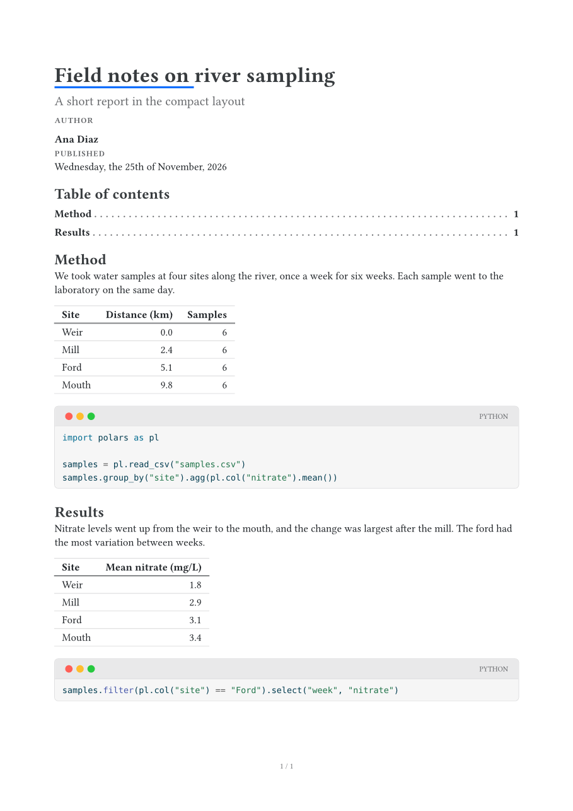
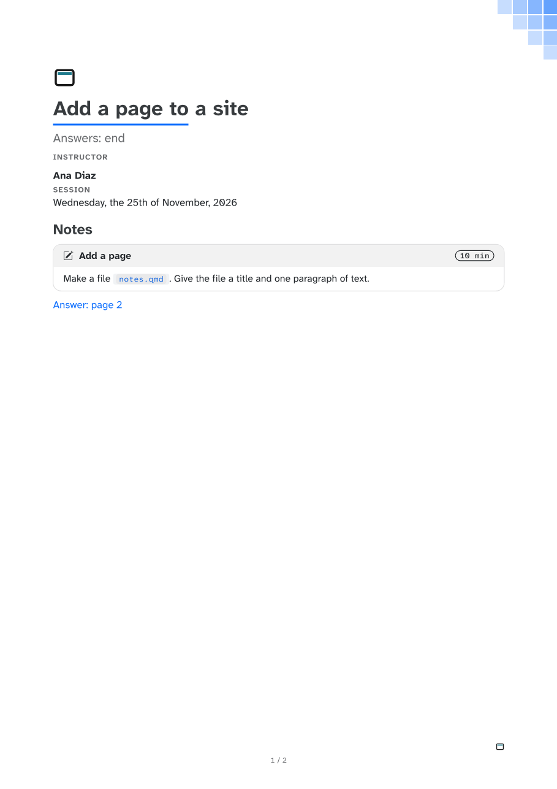
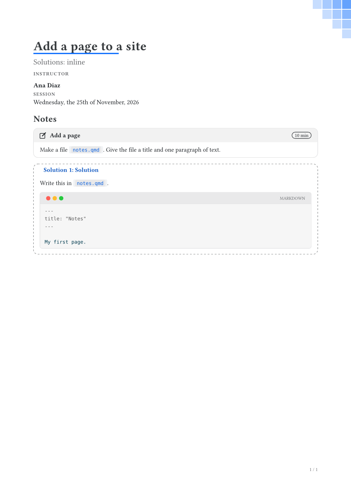
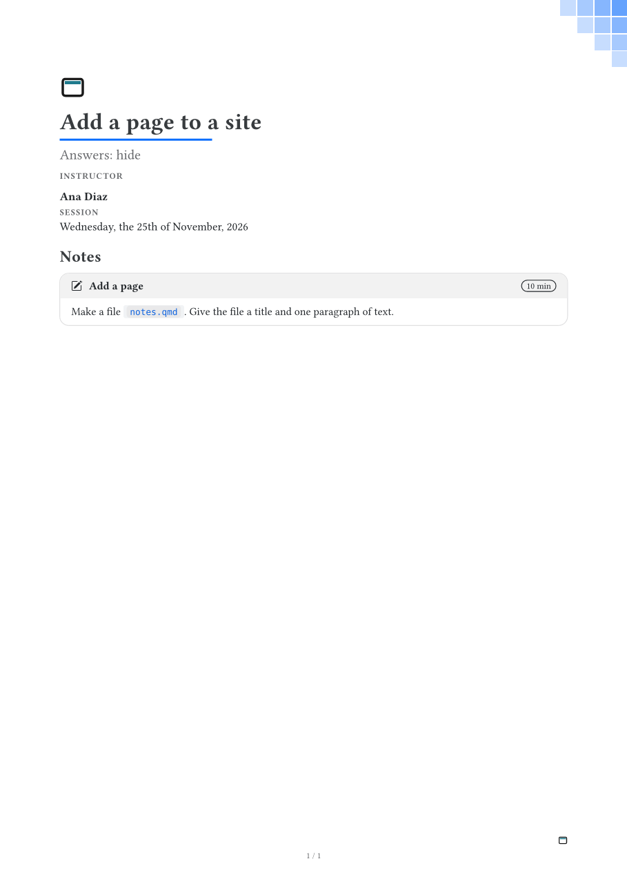
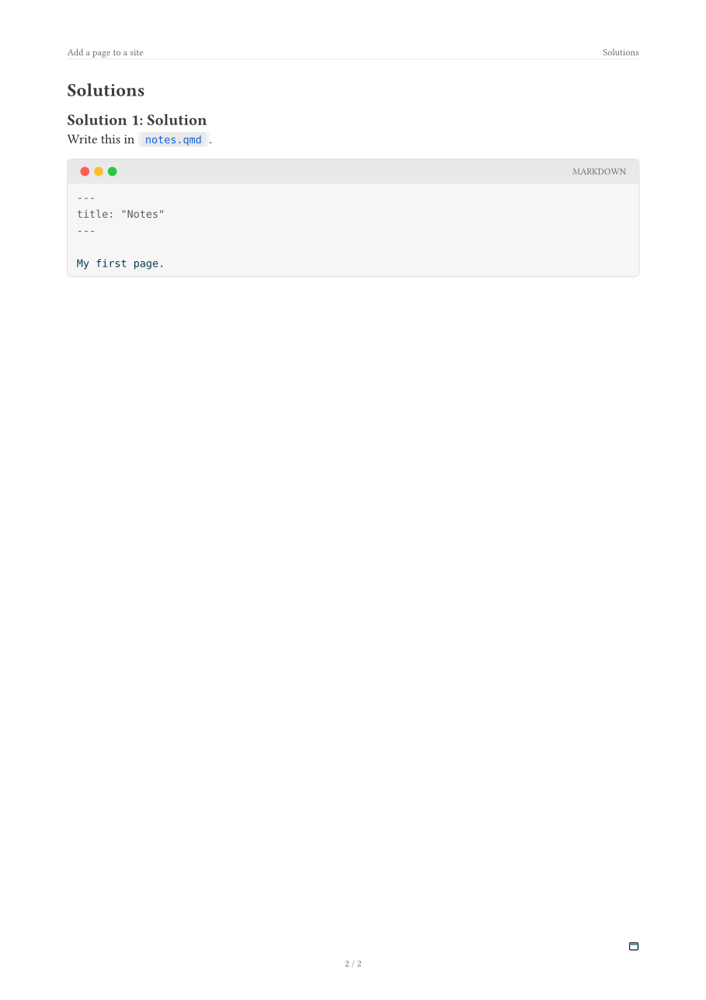
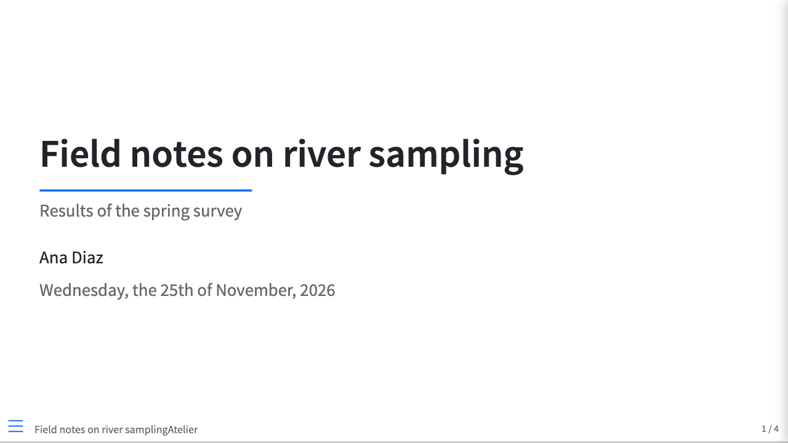
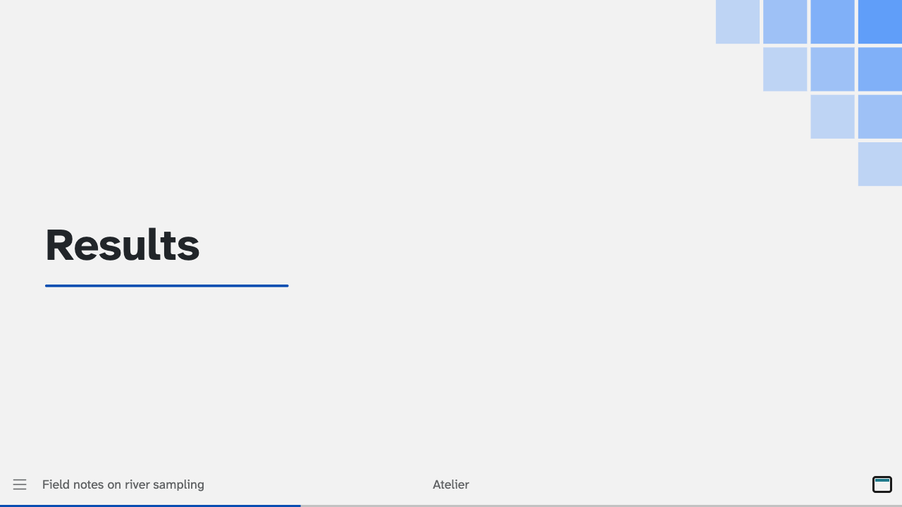
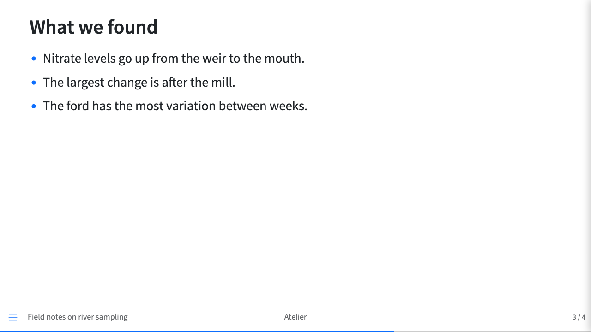
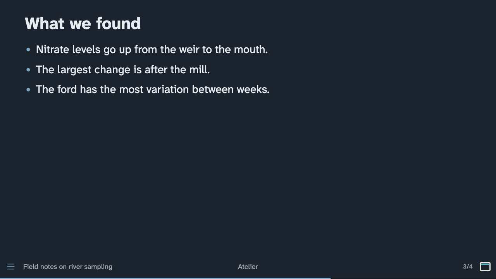

Atelier has three output formats.
They share one brand, one preset, and the same workshop blocks.

| Format             | Output                   | Use it for                                        |
| ------------------ | ------------------------ | ------------------------------------------------- |
| `atelier-html`     | A web page.              | The site. The project type sets this format.      |
| `atelier-typst`    | A PDF, made with Typst.  | A handout, a report, or a printed copy of a page. |
| `atelier-revealjs` | A Reveal.js slide deck.  | A talk or a workshop session.                     |

: The formats of Atelier. {.striped .hover tbl-colwidths="[22,24,54]"}

The [live demo workshop](demos/workshop-sidebar/index.html) shows all three.
Its home page has a PDF, [index.pdf](demos/workshop-sidebar/index.pdf), and a deck, [index-slides.html](demos/workshop-sidebar/index-slides.html).
The [documentation demo](demos/docs-navbar/index.html) does the same for a documentation page.

## Offer a format on a page

A page lists the formats that it wants in its front matter.
Quarto then adds an "Other Formats" list to the page, with a link to each other format.

```{.yaml filename="index.qmd"}
format:
  atelier-html: default
  atelier-typst: default
  atelier-revealjs:
    output-file: index-slides.html
```

Write the formats by the Atelier names.
A format called `typst` or `revealjs` does not get the Atelier look.

In a website, a page and its deck cannot both be `index.html`.
For this reason, give the deck its own file name with `output-file`.
Without it, Quarto stops the render with `NotFound: No such file or directory` when it moves the files into the output folder.

Set `website.site-url` in `_quarto.yml`.
The PDF and the deck use it to turn a relative link to another page into a link to the published site.
Without it, the render logs a warning from `portable-links`, and the links stay relative.
To turn the link change off and avoid the warning, set `extensions.portable-links.enabled: false`.

The formats work with each preset and each colour scheme of the brand.
The PDF and the deck take their colours, fonts, and syntax highlighting from the same `_brand.yml` as the site.
The `terminal` preset is dark in both schemes.

## The `atelier-typst` format

One document type serves every page.
By default, the PDF has a compact layout:

- A title block with the title, the subtitle, the authors, the date, and the logo.
- The table of contents, if `toc` is on.
- Numbered sections.

{.lightbox group="typst-compact" width="909" height="1286" fig-alt="The first page of a PDF in the compact layout: the title and subtitle at the top, the author and the date, a table of contents, and the start of the first numbered section."}

The defaults are an A4 page, margins of 20 mm and 25 mm, and PDF/UA-1, so the PDF is tagged for assistive technology.
Typst reads the fonts from the `fonts` folder of the extension.

### Page frame

Each page of the PDF has a header and a footer, which Atelier fills from the front matter.
The header shows the document title on the left and the current chapter on the right.
The footer shows three items on one line, and the page number below them:

- On the left, the first affiliation of the first author.
- In the centre, the `copyright` and the `license`.
- On the right, the logo.

An item with no value in the front matter leaves its place empty.
The logo comes from `logo` in the front matter, or else from the brand.
On a dark page, the PDF uses the dark image of the logo.

The first page has no header.
A cover, a divider and the closing page have no header.
Their footer shows only the copyright and the licence, where the first line of the footer sits.

### Report switches

Five switches under `extensions.atelier` turn on the parts of a long report.
Each switch is `false` by default, and only the Typst format reads them.

| Switch             | Effect                                                                                       |
| ------------------ | -------------------------------------------------------------------------------------------- |
| `cover`            | A cover page in place of the title block.                                                    |
| `toc-page`         | The table of contents on its own page. Quarto's `toc` still decides if there is a table.    |
| `chapter-dividers` | A divider page before each level-1 heading, and before each part.                           |
| `chapter-contents` | A contents page for each chapter, after its divider.                                         |
| `closing-page`     | A closing page at the end, with the closing text and a colophon.                             |

: The report switches of `atelier-typst`. {.striped .hover tbl-colwidths="[22,78]"}

```{.yaml filename="report.qmd"}
format: atelier-typst
toc: true
extensions:
  atelier:
    cover: true
    toc-page: true
    chapter-dividers: true
    chapter-contents: true
    closing-page: true
```

A level-1 heading with the class `.part` is a part of a book.
It has no number, and it gets a divider page if `chapter-dividers` is on.

```markdown
# Foundations {.part}
```

The pages below come from a report with the switches of this example, and a `.part` heading.

::: {layout-ncol=3}
{.lightbox group="typst-switches" width="909" height="1286" loading="lazy" fig-alt="A cover page with the title, the subtitle, the author, and the date, and no other text."}

{.lightbox group="typst-switches" width="909" height="1286" loading="lazy" fig-alt="A page that holds only the table of contents, with the sections and their page numbers."}

{.lightbox group="typst-switches" width="909" height="1286" loading="lazy" fig-alt="A divider page with the label Part and the title Foundations in large letters."}

{.lightbox group="typst-switches" width="909" height="1286" loading="lazy" fig-alt="A divider page with the label Chapter and the title Method in large letters."}

{.lightbox group="typst-switches" width="909" height="1286" loading="lazy" fig-alt="A page with the heading In this chapter and a list of the sections of the chapter with their page numbers."}

{.lightbox group="typst-switches" width="909" height="1286" loading="lazy" fig-alt="A closing page with the colophon Typeset with Quarto and Typst at the bottom left."}
:::

### Workshop handouts

The PDF shows the workshop blocks and the [workshop extras](workshop.qmd#authors) in both modes.
In workshop mode, it also shows the session duration and the workshop labels.

### Answers in a PDF

`extensions.atelier.answers` sets where the PDF puts the answers:

| Value    | Effect                                                                                      |
| -------- | ------------------------------------------------------------------------------------------- |
| `end`    | The default. The answers are at the end, and each exercise links to its answer.             |
| `inline` | Each answer stays under its exercise.                                                       |
| `hide`   | The PDF has no answers.                                                                     |

: The values of `extensions.atelier.answers`. {.striped .hover tbl-colwidths="[18,82]"}

The three PDFs below hold the same exercise and the same answer.

| `end` | `inline` | `hide` |
| ----- | -------- | ------ |
| {.lightbox group="typst-solutions" width="909" height="1286" loading="lazy" fig-alt="A PDF page with the exercise Add a page and a link, Solution: page 2, under it."} | {.lightbox group="typst-solutions" width="909" height="1286" loading="lazy" fig-alt="A PDF page with the exercise Add a page and its solution in a dashed frame under it."} | {.lightbox group="typst-solutions" width="909" height="1286" loading="lazy" fig-alt="A PDF page with the exercise Add a page and no solution."} |
| {.lightbox group="typst-solutions" width="909" height="1286" loading="lazy" fig-alt="The last page of the PDF with the heading Solutions and the text of the solution."} | | |

: The same handout with each value of `extensions.atelier.answers`. {.striped .hover}

Any other value logs a warning, and Atelier uses `end`.
Quarto's own `.solution` blocks stay in place, and a reference such as `@sol-a` links to the solution in each format.

## The `atelier-revealjs` format

The deck is 1280 by 720 pixels.
It shows the slide number as "n/total" and a progress bar.

- The title slide shows the title, the subtitle, the authors, and the date.
- Each level-1 heading makes a section slide, painted with the chrome colours of the site.
- A slide with the class `.dark` uses the dark colours.
- The menu button, the chalkboard buttons, and the footer share one row at the bottom of each slide.
- The footer shows the title of the document on the left and your `footer` text in the centre.
  The slide number is at the right end of that row, or in the top-right corner when the deck has a logo.
- With a logo, the title slide shows it above the title, and the other slides show it at the right end of that row.
  A dark slide shows the dark image of the logo.
- The title slide shows only your `footer` text in that row, with no slide number.
  A section slide shows no slide number.

::: {layout-ncol=2}
{.lightbox group="revealjs-slides" width="1280" height="720" loading="lazy" fig-alt="The title slide of a deck: the title, the subtitle, the author, and the date on a pale page."}

{.lightbox group="revealjs-slides" width="1280" height="720" loading="lazy" fig-alt="A section slide with the title Results and a blue rule under it, on a pale grey page."}

{.lightbox group="revealjs-slides" width="1280" height="720" loading="lazy" fig-alt="A content slide with a heading, three bullet points, and a footer with the document title, the footer text, and the slide number."}

{.lightbox group="revealjs-slides" width="1280" height="720" loading="lazy" fig-alt="A slide on a dark navy page with a heading and one sentence in light text."}
:::

The deck is light, or dark if you set `brand-mode: dark`.

{.lightbox group="revealjs-slides" width="1280" height="720" loading="lazy" fig-alt="A content slide on a dark navy page with a heading and three bullet points in light text."}
A reader cannot switch the colour scheme of a deck.
Use `.dark` on single slides when you want a contrast.

```markdown
## A dark slide {.dark}

This slide uses the dark colours.
```

The deck shows the workshop blocks in both modes.
Its answers go into the veil group `answers`, which is hidden when the deck opens.

The embedded extensions cascade, codefrag, tabset, and a11y add to the deck.
The [reference](reference.qmd#embedded-extensions) lists them with their options.

## Limits

- `atelier-html` pages keep the full site chrome.
  The PDF and the deck do not show the navbar, the sidebar, or the workshop bar.
- The report switches have no effect in HTML and Reveal.js.
- Typst cannot read WOFF2 fonts.
  Atelier holds static TrueType cuts of its fonts for this reason.
