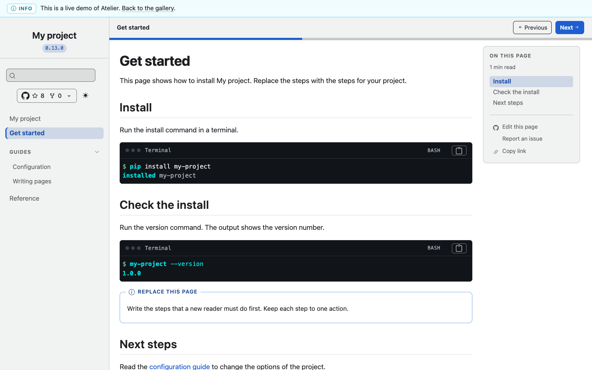
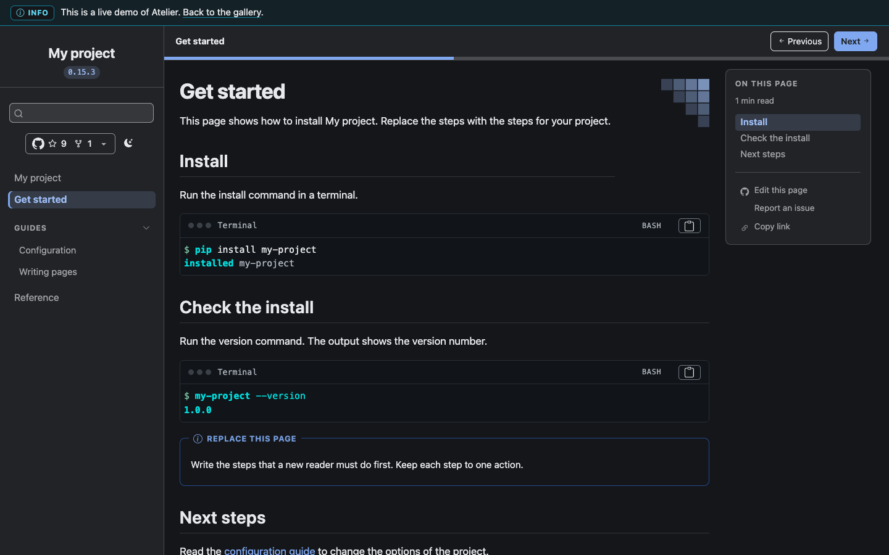
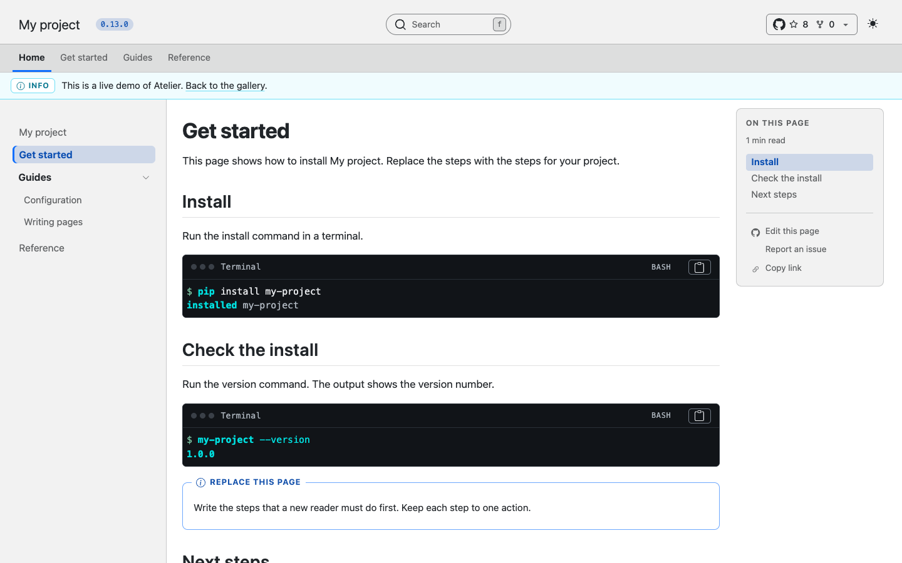
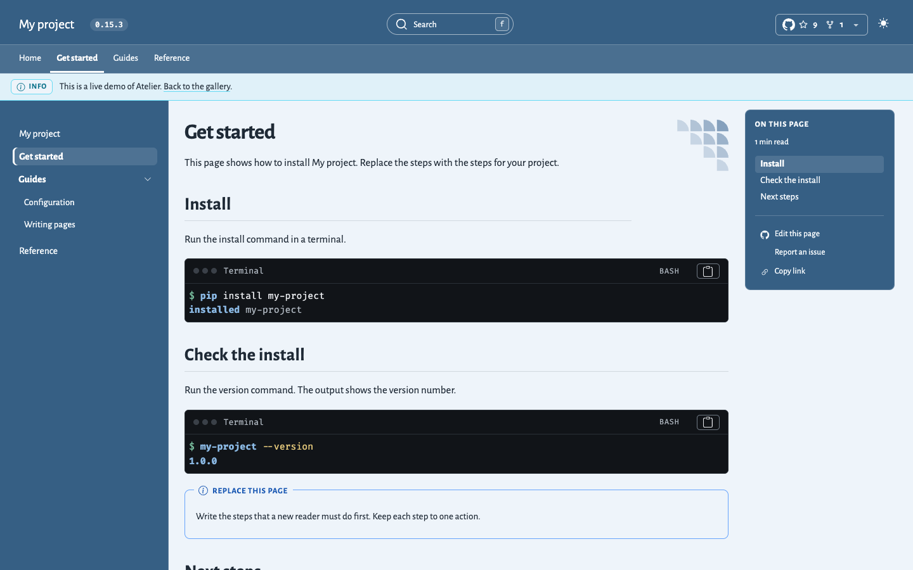
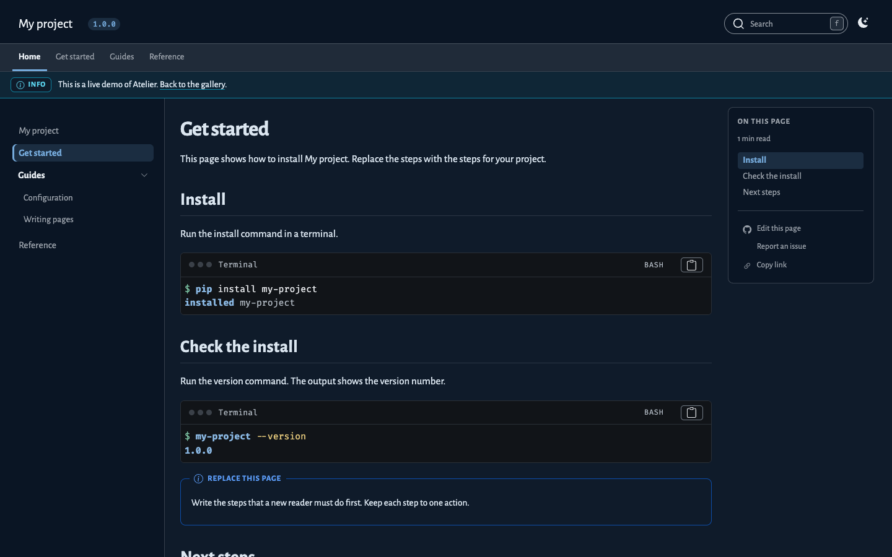

Atelier has two modes and two layouts.
Each section below shows one combination in the light and the dark colour scheme.
Each section also gives the YAML that you write in `_quarto.yml` to get it, and a link to a live demo.
The demos are real sites that you can click through.
Each block shows only the keys that set the layout and the mode, on top of `project.type: atelier`.
The template link under each block gives the full configuration.

## Workshop mode, sidebar only

This layout has no navbar.
The sidebar holds the modules of the course, with their durations and your progress.
Workshop mode also needs its sidebar named in `extensions.atelier.sidebars`, as [Declare the sidebar](workshop.qmd#declare-the-sidebar) describes.

::: {layout-ncol=2}
{fig-alt="A workshop page with a sidebar of numbered modules and durations, a timer and Previous and Next buttons in a top bar, and a table of contents on the right, in the light colour scheme."}

{fig-alt="A workshop page with a sidebar of numbered modules and durations, a timer and Previous and Next buttons in a top bar, and a table of contents on the right, in the dark colour scheme."}
:::

```{.yaml filename="_quarto.yml"}
extensions:
  atelier:
    mode: workshop
website:
  navbar: false
  search:
    location: sidebar
    type: textbox
```

[Open the live demo](demos/workshop-sidebar/index.html){.btn .btn-primary}

This demo comes from the [workshop template](https://github.com/mcanouil/quarto-atelier/tree/main/templates/workshop).

## Workshop mode, navbar

This layout keeps a navbar above the workshop chrome.
The search is a button in the navbar.
Workshop mode also needs its sidebar named in `extensions.atelier.sidebars`, as [Declare the sidebar](workshop.qmd#declare-the-sidebar) describes.

::: {layout-ncol=2}
{fig-alt="A workshop page with a navbar and a search button on top, then the module sidebar, the timer bar, and the page content, in the light colour scheme."}

{fig-alt="A workshop page with a navbar and a search button on top, then the module sidebar, the timer bar, and the page content, in the dark colour scheme."}
:::

```{.yaml filename="_quarto.yml"}
extensions:
  atelier:
    mode: workshop
website:
  navbar:
    left:
      - href: index.qmd
        text: "Home"
  search:
    location: navbar
    type: overlay
```

[Open the live demo](demos/workshop-navbar/index.html){.btn .btn-primary}

This demo comes from the [workshop template](https://github.com/mcanouil/quarto-atelier/tree/main/templates/workshop).

## Documentation mode, navbar

This is the default layout.
The navbar holds the top-level pages, and a docked sidebar holds the pages of the section.

::: {layout-ncol=2}
{fig-alt="A documentation page with a navbar of top-level links, a docked sidebar of pages, the page content, and a table of contents on the right, in the light colour scheme."}

{fig-alt="A documentation page with a navbar of top-level links, a docked sidebar of pages, the page content, and a table of contents on the right, in the dark colour scheme."}
:::

```{.yaml filename="_quarto.yml"}
website:
  navbar:
    left:
      - text: "Home"
        href: index.qmd
      - text: "Get started"
        href: get-started.qmd
  sidebar:
    style: docked
    contents:
      - index.qmd
      - get-started.qmd
```

[Open the live demo](demos/docs-navbar/index.html){.btn .btn-primary}

This demo comes from the [documentation template](https://github.com/mcanouil/quarto-atelier/tree/main/templates/documentation).

## Documentation mode, sidebar only

This layout has no navbar.
The docked sidebar carries the navigation and the search, like a book.

::: {layout-ncol=2}
{fig-alt="A documentation page with no navbar, a docked sidebar with a search field and grouped pages, the page content, and a table of contents on the right, in the light colour scheme."}

{fig-alt="A documentation page with no navbar, a docked sidebar with a search field and grouped pages, the page content, and a table of contents on the right, in the dark colour scheme."}
:::

```{.yaml filename="_quarto.yml"}
website:
  navbar: false
  search:
    location: sidebar
    type: textbox
```

[Open the live demo](demos/docs-sidebar/index.html){.btn .btn-primary}

This demo comes from the [documentation template](https://github.com/mcanouil/quarto-atelier/tree/main/templates/documentation).

## Presets

A preset sets the colours, the fonts, and the syntax highlighting.
A preset applies to any layout and mode.
Set it with `atelier-preset` in `_brand.yml`.
The presets have no live demo.

### The default preset

::: {layout-ncol=2}
{fig-alt="The default preset in the light colour scheme: a pale page with a navbar, a sidebar, a table of contents, and a code block."}

{fig-alt="The default preset in the dark colour scheme: a dark page with a navbar, a sidebar, a table of contents, and a code block."}
:::

```{.yaml filename="_brand.yml"}
defaults:
  bootstrap:
    defaults:
      atelier-preset: default
```

### The quarto preset

::: {layout-ncol=2}
{fig-alt="The quarto preset in the light colour scheme: a pale blue page under a filled blue navbar and sidebar, with a dark code block."}

{fig-alt="The quarto preset in the dark colour scheme: a dark page with a navbar, a sidebar, and a code block."}
:::

```{.yaml filename="_brand.yml"}
defaults:
  bootstrap:
    defaults:
      atelier-preset: quarto
```

### The terminal preset

The terminal preset has a dark colour scheme only.

{fig-alt="The terminal preset: a near-black page with green accents, a prompt and a cursor in the title, and monospace text."}

```{.yaml filename="_brand.yml"}
defaults:
  bootstrap:
    defaults:
      atelier-preset: terminal
```
