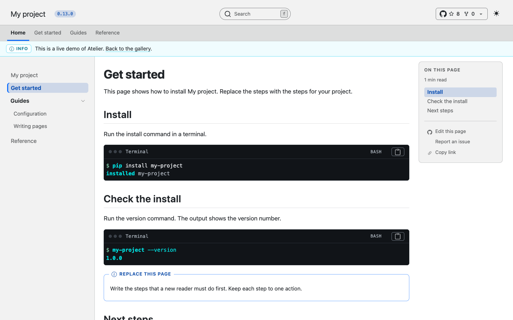

Atelier has three blocks for a landing page: a hero, a feature row and a card grid.
You write each block as a fenced div with an Atelier class.
There is no option to set, no filter and no template.
The [home page](index.qmd) of this site uses all three blocks.

Each section below shows a block, then the Markdown that makes it.
Copy the Markdown into your page, then replace the text, the links and the images.
The [Reference](reference.qmd#landing-page) lists every class and modifier.

## Page set-up

Put the blocks in an `.atelier-landing` div, on a page with `page-layout: full` and `title-block-style: none`.
The container sets the width of the blocks and centres them.
On a page that has this container, Atelier hides the title block, because the hero shows the h1.
The `title` in the front matter still gives the page its `<title>` and its social metadata.

````markdown
---
title: "Project name"
page-layout: full
title-block-style: none
toc: false
anchor-sections: false
---

::: {.atelier-landing}

Put the hero, the feature rows and the card grid here.

:::
````

The blocks also work without the container, on a page with the usual layout, as on this page.

## Hero

The hero has a text part and a figure part, side by side.
The text part holds an eyebrow, the h1, a lead and a row of buttons.
Below the `md` breakpoint, the figure goes below the text.

::: {.atelier-hero}

::: {.atelier-hero-text}

[Version 1.0]{.atelier-eyebrow}

## Project name {.unlisted}

[One sentence that says what the project does.]{.atelier-lead}

::: {.atelier-actions}

[Get started](https://example.com/start){.btn .btn-primary .btn-lg}
[Read the guide](https://example.com/guide){.btn .btn-outline-primary .btn-lg}

:::

:::

::: {.atelier-hero-figure}

[{.nolightbox width="320" height="320"}]{}

:::

:::

````markdown
::: {.atelier-hero}

::: {.atelier-hero-text}

[Version 1.0]{.atelier-eyebrow}

# Project name

[One sentence that says what the project does.]{.atelier-lead}

::: {.atelier-actions}

[Get started](https://example.com/start){.btn .btn-primary .btn-lg}
[Read the guide](https://example.com/guide){.btn .btn-outline-primary .btn-lg}

:::

:::

::: {.atelier-hero-figure}

[{width="320" height="320"}]{}

:::

:::
````

The image is in an empty span, `[...]{}`, so that Quarto shows it without a caption.
The text in the square brackets of the image is its alternative text.

A wide image, such as a social card, goes below the text and takes the full width of the hero, so that its text stays readable.
Atelier finds a wide image from its `width` and `height` attributes, in pixels such as `600` or `600px`: the width is at least 1.5 times the height.
Without the two attributes, the image stays beside the text.

::: {#hero-wide .atelier-hero}

::: {.atelier-hero-text}

## Project name {.unlisted}

[One sentence that says what the project does.]{.atelier-lead}

:::

::: {.atelier-hero-figure}

[{.nolightbox width="600" height="315"}]{}

:::

:::

The examples on this page differ from their Markdown in three ways only.
This page has its own h1, so the title of each example hero is an h2.
Atelier styles an h1 or an h2 in a hero as the hero title.
Each heading has an `{.unlisted}` attribute, which keeps it out of the table of contents of this page.
A landing page with `toc: false` does not need this attribute.
Each image is the Atelier mark, where the Markdown has `logo.png` or `screenshot.png`.

## Install tabset

A Quarto tabset in the text part shows how to install the project.
Atelier gives it a maximum width and a top margin, and keeps the usual tabset style.

::: {.atelier-hero .centred}

::: {.atelier-hero-text}

## Project name {.unlisted}

::: {.panel-tabset}

## Terminal

```{.bash filename="Terminal"}
quarto add owner/project
```

## From source

```{.bash filename="Terminal"}
git clone https://example.com/project.git
```

:::

:::

:::

`````markdown
::: {.atelier-hero .centred}

::: {.atelier-hero-text}

# Project name

::: {.panel-tabset}

## Terminal

```{.bash filename="Terminal"}
quarto add owner/project
```

## From source

```{.bash filename="Terminal"}
git clone https://example.com/project.git
```

:::

:::

:::
`````

Put the tabset in `.atelier-hero-text`, after `.atelier-actions` when the hero has buttons.

## Centred hero

The `.centred` modifier centres the text part and removes the second column.
Do not add a figure part to a centred hero.

::: {.atelier-hero .centred}

::: {.atelier-hero-text}

[Version 1.0]{.atelier-eyebrow}

## Project name {.unlisted}

[One sentence that says what the project does.]{.atelier-lead}

::: {.atelier-actions}

[Get started](https://example.com/start){.btn .btn-primary .btn-lg}

:::

:::

:::

````markdown
::: {.atelier-hero .centred}

::: {.atelier-hero-text}

[Version 1.0]{.atelier-eyebrow}

# Project name

[One sentence that says what the project does.]{.atelier-lead}

::: {.atelier-actions}

[Get started](https://example.com/start){.btn .btn-primary .btn-lg}

:::

:::

:::
````

## Banner hero

The `.banner` modifier puts the hero on a tinted surface with a border.
You can use it with the split hero or with `.centred`.

::: {.atelier-hero .centred .banner}

::: {.atelier-hero-text}

## Project name {.unlisted}

[One sentence that says what the project does.]{.atelier-lead}

:::

:::

````markdown
::: {.atelier-hero .centred .banner}

::: {.atelier-hero-text}

# Project name

[One sentence that says what the project does.]{.atelier-lead}

:::

:::
````

## Framed figure

The `.framed` modifier goes on the figure part, `.atelier-hero-figure`.
It draws the image in a frame with an ink border, an offset ink shadow and padding around the image.
The frame looks like a card, but its shadow is ink, not the accent colour, and the frame is turned by a small angle.
The angle is the same for every framed image, and it does not move.
Use it for a screenshot of a page.
The frame is drawn from the page ink and paper, so it follows the colour scheme.

::: {.atelier-hero}

::: {.atelier-hero-text}

## Project name {.unlisted}

[One sentence that says what the project does.]{.atelier-lead}

:::

::: {.atelier-hero-figure .framed}

[{.nolightbox width="1440" height="900"}]{}

:::

:::

````markdown
::: {.atelier-hero}

::: {.atelier-hero-text}

# Project name

[One sentence that says what the project does.]{.atelier-lead}

:::

::: {.atelier-hero-figure .framed}

[{width="1440" height="900"}]{}

:::

:::
````

## Feature row

A feature row has a text part and a figure part, side by side.
The figure part can hold an image, a code block or other content.
Two feature rows that come one after the other have a line between them.

::: {.atelier-feature}

::: {.atelier-feature-text}

[Feature]{.atelier-eyebrow}

## A feature in a few words {.unlisted}

One or two sentences that tell the reader what this feature does for them.

:::

::: {.atelier-feature-figure}

```{.yaml filename="_quarto.yml"}
project:
  type: website
```

:::

:::

`````markdown
::: {.atelier-feature}

::: {.atelier-feature-text}

[Feature]{.atelier-eyebrow}

## A feature in a few words

One or two sentences that tell the reader what this feature does for them.

:::

::: {.atelier-feature-figure}

```{.yaml filename="_quarto.yml"}
project:
  type: website
```

:::

:::
`````

## Reversed feature row

The `.reverse` modifier puts the figure part on the left.
Below the `md` breakpoint, the text part is always first.

::: {.atelier-feature .reverse}

::: {.atelier-feature-text}

[Feature]{.atelier-eyebrow}

## A second feature {.unlisted}

One or two sentences that tell the reader what this feature does for them.

:::

::: {.atelier-feature-figure}

[{.nolightbox width="240" height="240"}]{}

:::

:::

````markdown
::: {.atelier-feature .reverse}

::: {.atelier-feature-text}

[Feature]{.atelier-eyebrow}

## A second feature

One or two sentences that tell the reader what this feature does for them.

:::

::: {.atelier-feature-figure}

[{width="240" height="240"}]{}

:::

:::
````

## Numbered legend

A numbered legend explains the parts of a figure, step by step.
Put an ordered list in an `.atelier-legend` div, in the text part.
Each item has a short title and, in an `.atelier-detail` span, one sentence of detail.

::: {.atelier-feature}

::: {.atelier-feature-text}

## Three steps {.unlisted}

::: {.atelier-legend}

1. Install the project.
   [Run the install command in a terminal.]{.atelier-detail}
2. Write a page.
   [Add a Markdown file to the project.]{.atelier-detail}
3. Render the site.
   [Run `quarto render`, then publish the output.]{.atelier-detail}

:::

:::

::: {.atelier-feature-figure}

```{.bash filename="Terminal"}
quarto render
```

:::

:::

`````markdown
::: {.atelier-feature}

::: {.atelier-feature-text}

## Three steps

::: {.atelier-legend}

1. Install the project.
   [Run the install command in a terminal.]{.atelier-detail}
2. Write a page.
   [Add a Markdown file to the project.]{.atelier-detail}
3. Render the site.
   [Run `quarto render`, then publish the output.]{.atelier-detail}

:::

:::

::: {.atelier-feature-figure}

```{.bash filename="Terminal"}
quarto render
```

:::

:::
`````

## Card grid

A card grid holds cards in columns that fit the width of the page.
Each card has an icon, a heading, one sentence and one link.
The link covers the whole card, so a click on the card opens the link.
On hover and on focus, the card gets an offset shadow in the accent colour, and moves up and to the left by 2px.
Under `prefers-reduced-motion: reduce`, the card does not move, and keeps the shadow.
The link text is the name of the link for a screen reader, so write text that says where the link goes.
When the link has keyboard focus, the focus ring goes around the card.

Put only one link in a card.
Atelier hides the anchor link of the card heading, because it is a second link below the card link.

::: {.atelier-cards}

::: {.atelier-card}



### Get started {.unlisted}

Install the project and build a first page.

[Read the guide](https://example.com/guide)

:::

::: {.atelier-card}



### Reference {.unlisted}

Every option of the project.

[Open the reference](https://example.com/reference)

:::

::: {.atelier-card}



### Questions {.unlisted}

Ask the community for help.

[Go to the forum](https://example.com/forum)

:::

:::

````markdown
::: {.atelier-cards}

::: {.atelier-card}

{}

### Get started

Install the project and build a first page.

[Read the guide](https://example.com/guide)

:::

::: {.atelier-card}

{}

### Reference

Every option of the project.

[Open the reference](https://example.com/reference)

:::

::: {.atelier-card}

{}

### Questions

Ask the community for help.

[Go to the forum](https://example.com/forum)

:::

:::
````

The icon is an `iconify` shortcode with `aria-hidden='true'`, because the heading already names the card.

## Compact cards

The `.compact` modifier makes smaller cards, with the icon and the heading on one line.
A compact card has no text: put the link in the heading.

::: {.atelier-cards .compact}

::: {.atelier-card}



### [Changelog](https://example.com/changelog) {.unlisted}

:::

::: {.atelier-card}



### [Source code](https://example.com/source) {.unlisted}

:::

:::

````markdown
::: {.atelier-cards .compact}

::: {.atelier-card}

{}

### [Changelog](https://example.com/changelog)

:::

::: {.atelier-card}

{}

### [Source code](https://example.com/source)

:::

:::
````

## Full page

This skeleton is a complete landing page with the three blocks.
Save it as the `index.qmd` of your site, then replace the text, the links and the images.

`````{.markdown filename="index.qmd"}
---
title: "Project name"
description: "One sentence that says what the project does."
page-layout: full
title-block-style: none
toc: false
anchor-sections: false
---

::: {.atelier-landing}

::: {.atelier-hero}

::: {.atelier-hero-text}

[Version 1.0]{.atelier-eyebrow}

# Project name

[One sentence that says what the project does.]{.atelier-lead}

::: {.atelier-actions}

[Get started](https://example.com/start){.btn .btn-primary .btn-lg}
[Read the guide](https://example.com/guide){.btn .btn-outline-primary .btn-lg}

:::

:::

::: {.atelier-hero-figure}

[{width="320" height="320"}]{}

:::

:::

::: {.atelier-feature}

::: {.atelier-feature-text}

[Feature]{.atelier-eyebrow}

## A feature in a few words

One or two sentences that tell the reader what this feature does for them.

:::

::: {.atelier-feature-figure}

[{width="640" height="400"}]{}

:::

:::

::: {.atelier-feature .reverse}

::: {.atelier-feature-text}

## Three steps

::: {.atelier-legend}

1. Install the project.
   [Run the install command in a terminal.]{.atelier-detail}
2. Write a page.
   [Add a Markdown file to the project.]{.atelier-detail}
3. Render the site.
   [Run `quarto render`, then publish the output.]{.atelier-detail}

:::

:::

::: {.atelier-feature-figure}

```{.bash filename="Terminal"}
quarto render
```

:::

:::

## Where next

::: {.atelier-cards}

::: {.atelier-card}

{}

### Get started

Install the project and build a first page.

[Read the guide](https://example.com/guide)

:::

::: {.atelier-card}

{}

### Reference

Every option of the project.

[Open the reference](https://example.com/reference)

:::

:::

:::
`````
