Workshop mode turns one sidebar of a site into a course.
Each top-level item of that sidebar is a module.
The pages in workshop mode get the workshop chrome.

The [live demo workshop](demos/workshop-sidebar/index.html) uses each part that this page describes.
The [workshop template](templates.qmd) gives you a workshop site to start from.
Workshop mode needs Quarto 1.12.1 or later.

## Set the mode

The mode option is `extensions.atelier.mode`.
Its values are `documentation` (the default) and `workshop`.
A site is a workshop or a documentation site.
Set the mode once for the whole site, in `_quarto.yml`:

```{.yaml filename="_quarto.yml"}
extensions:
  atelier:
    mode: workshop
```

The `_metadata.yml` of a folder and the front matter of a page can also set the option.
A folder `_metadata.yml` can turn on workshop mode for the pages of one folder, in a site that is otherwise documentation.
This is an example of such a file:

```{.yaml filename="workshop/_metadata.yml"}
extensions:
  atelier:
    mode: workshop
```

A page in workshop mode that no sidebar of `extensions.atelier.sidebars` lists, such as `404.qmd`, shows no workshop chrome.

## Declare the sidebar

A workshop has its own sidebar in `website.sidebar`, with an `id`.
Atelier cannot read `website.sidebar`, so you also list the sidebar in `extensions.atelier.sidebars`.
To do this without a second copy, put a YAML anchor on the sidebar and its alias in the list:

```{.yaml filename="_quarto.yml"}
website:
  sidebar:
    - &course
      id: course
      title: "My workshop"
      style: docked
      contents:
        - section: "Set-up"
          contents:
            - workshop/setup/index.qmd
            - workshop/setup/install.qmd
        - section: "Practice"
          contents:
            - workshop/practice.qmd

extensions:
  atelier:
    sidebars:
      - *course
```

The anchor (`&course`) and the alias (`*course`) must be in the same YAML file.
If the anchor is in one file and the alias is in another file, Quarto stops the render with `YAMLException: unidentified alias`.

You can keep both in a separate file, and name that file in `metadata-files`.
The workshop template does this with `_sidebars.yml`:

```{.yaml filename="_quarto.yml"}
metadata-files:
  - _sidebars.yml
```

The `extensions.atelier` options of `_sidebars.yml` merge with the options of `_quarto.yml`.
A site with more than one sidebar lists each one in `extensions.atelier.sidebars`.
This site lists only its `docs` sidebar.

The `id` of the sidebar is part of the key that stores the progress of the reader.
If you change the `id`, each reader starts again with no progress.

## Modules and durations

A module is a top-level section of the workshop sidebar.
The pages of the section are the steps of the module.
A top-level page, with no section, is a module of one page.

A page sets its duration in its front matter, with `extensions.atelier.duration`:

```{.yaml filename="workshop/setup/install.qmd"}
---
title: "Install the tools"
extensions:
  atelier:
    duration: 25 min
---
```

A duration has one of these four forms:

- Minutes: `25 min`.
- Hours: `1 h`.
- Hours and minutes: `1 h 30 min`.
- A number with no unit, which counts as minutes: `25`.

The spaces are optional, so `1h30min` is also correct.
If a duration has a different form, Atelier logs a warning and ignores the duration.

The duration of a module is the sum of the durations of its pages.
The total time of the workshop is the sum of the durations of all its pages.
A page with no duration adds nothing to the sums, and it shows no timer.

## The workshop chrome

The workshop chrome shows the same course in each layout.
The layout changes where the bar is.

::: {layout-ncol=2}
[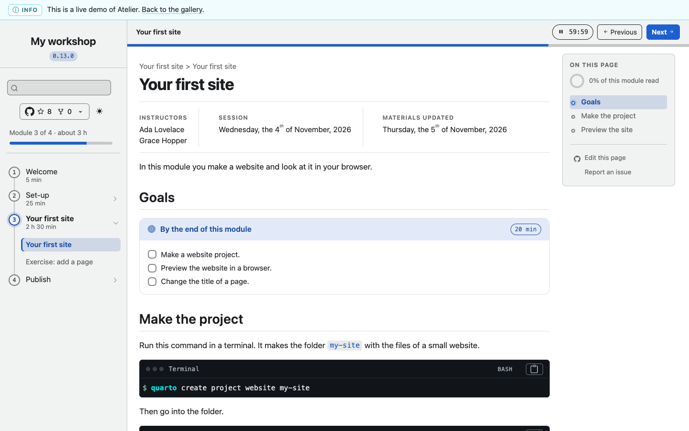{.nolightbox width="1440" height="900" loading="lazy" fig-alt="A workshop page with a sidebar of numbered modules and durations, a timer and Previous and Next buttons in a top bar, and a table of contents on the right, in the light colour scheme."}](demos/workshop-sidebar/index.html)

[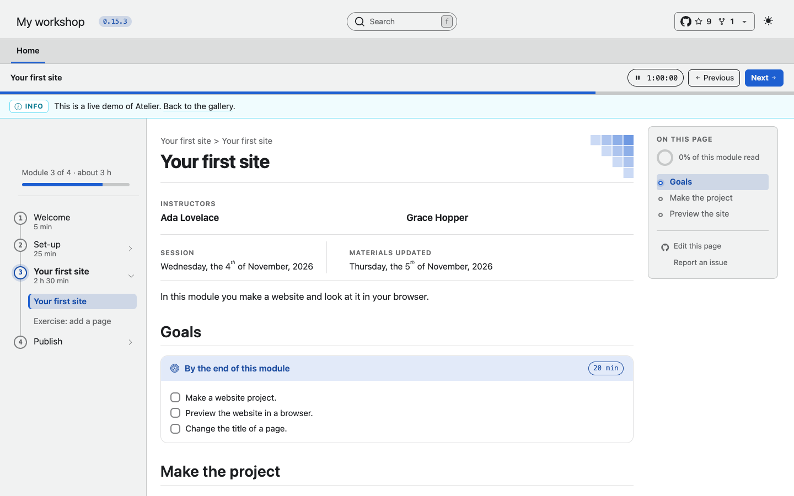{.nolightbox width="1440" height="900" loading="lazy" fig-alt="A workshop page with a navbar and a search button on top, then the module sidebar, the timer bar, and the page content, in the light colour scheme."}](demos/workshop-navbar/index.html)
:::

Select a picture to open the live demo of the sidebar-only layout or the navbar layout.

| Part              | Sidebar-only layout                                     | Navbar layout                                     |
| ----------------- | ------------------------------------------------------- | ------------------------------------------------- |
| Workshop bar      | At the top of the content, next to the sidebar.         | A module row below the navbar.                    |
| Course stepper    | In the sidebar.                                         | In the sidebar.                                   |
| Progress dots     | In the table of contents.                               | In the table of contents.                         |

: Where the parts of the workshop chrome are. {.striped .hover tbl-colwidths="[20,40,40]"}

The workshop bar shows these items:

- The name of the module and the name of the page.
  If the module and the page have the same name, the bar shows the name of the page only.
- The previous and next links.
- A progress line, "Module n of m".
- The session timer, if the page has a duration.

The timer counts down from the duration of the page.
It starts when the page opens, starts again each time the page opens, and stops at `0:00`.
The pause button stops and starts the timer.
The timer does not announce each second to a screen reader.

The course stepper numbers each module and shows its duration.
A summary at the top shows "Module n of m", the total time, and a progress bar.
The current module is open and lists its pages.
When the reader has opened all the pages of a module, the module shows a check mark.

The progress dots put a dot next to each heading of the table of contents.
A dot is filled when the top of its heading goes past the top of the window.
A ring above the entries shows the part of the current module that the reader has read, for example "40% of this module read".

Without JavaScript, the bar, the stepper, and the dots are not shown.
The previous and next links of Quarto at the bottom of the page continue to work.

In documentation mode with no navbar, a reading bar above the page shows the section, the page, "Page n of m", and the previous and next links.
It has no timer.

## Workshop blocks

The workshop blocks are divs with a class.
They work in both modes, on a documentation page as on a workshop page.

### Objectives

An `.objectives` div holds a bullet list.
Each item becomes a checkbox with a label, and the reader can tick it.
The default title is "By the end of this module, you can".

```markdown
::: {.objectives title="After this page, you can" duration="15 min"}

- Install Quarto.
- Read the version of Quarto in a terminal.

:::
```

The `title` and `duration` attributes are optional.
In workshop mode, a block with no `duration` attribute shows the duration of the page.
In documentation mode, the page has no duration, so give the block its own `duration` attribute.
The [Set up](demos/workshop-sidebar/workshop/setup/index.html#goals) page of the demo shows this block.

### Exercise

An `.exercise` div has a header with a title and an optional duration.
The default title is "Exercise".

```markdown
::: {.exercise title="Add a page" duration="10 min"}

Make a file `notes.qmd`.
Give the file a title and one paragraph of text.

:::
```

The [Exercise](demos/workshop-sidebar/workshop/first-site/exercise.html#the-task) page of the demo shows this block.

### Answer

An `.answer` div becomes a disclosure that is closed at first.
The reader opens it to see the answer.
The summary text comes from the `title` attribute.
If there is no `title`, it comes from the `name` attribute or from a heading at the start of the div.
The default summary is "Show the answer".

In a PDF, `extensions.atelier.answers` places the answers: `end`, `inline`, or `hide`.
See [Answers in a PDF](formats.qmd#answers-in-a-pdf).
In a Reveal.js deck, each answer goes into the veil group `answers`.
The answers are hidden when the deck opens.
The reader can show or hide all the answers of the deck with the veil controls.
An answer with its own `.veil` class or its own `group` attribute keeps them.
Atelier declares the group `answers` with the label "Answers", hidden at first.
To change the label or the start state, declare `answers` under `extensions.veil.groups`, and Atelier keeps your declaration.

```markdown
::: {.answer title="Answer"}

Write this in `notes.qmd`.

:::
```

Quarto has its own `.solution` block, and Atelier does not change it.
Use `.solution` when you want a Quarto cross-reference, such as `@sol-notes`.
A `.solution` div needs an `id` that starts with `sol-`, or no `id`.
Quarto stops the render on a solution with a different prefix ([quarto-cli#15113](https://github.com/quarto-dev/quarto-cli/issues/15113)).
Quarto reads every div with an `id` that starts with `sol-` as a Quarto solution, also a div with the class `answer`.
For this reason, an `.answer` with such an `id` stays a Quarto solution, and Atelier logs a warning.
Give an answer no `id`, or an `id` with a different prefix.
The [Exercise](demos/workshop-sidebar/workshop/first-site/exercise.html#the-task) page of the demo shows an answer after the exercise.

### Terminal

A code block with the class `.terminal` shows a shell session.
The terminal block works in both modes.
It stays dark in both colour schemes.

````markdown
```{.bash .terminal}
$ quarto --version
1.12.1
```
````

Atelier reads each line of the block as follows:

- A line that starts with `$` and a space is a command.
- A line that is only `$` shows an empty prompt.
- If a command ends with `\`, the next line continues the command.
  This line has the command colour and no prompt.
- A line that starts with spaces before the `$` is output, as in usage text.
- Each other line is output.

Atelier removes the `$` from the text and draws it as a prompt.
For this reason, the copy button copies the commands without the prompt, and screen readers do not read it.

The header shows "Terminal", unless the block has a `filename`.
The block needs a language class, such as `bash`.
If it has no language class, Atelier logs a warning and shows the block as a normal code block.
The [Set up](demos/workshop-sidebar/workshop/setup/index.html#check-your-set-up) page of the demo shows a terminal block.

### Prerequisites

A `.prerequisites` div tells the learner what to have before the page.
It has a label, an icon, and an optional duration, like the other blocks.
The default title is "Prerequisites".

```markdown
::: {.prerequisites title="Before you start" duration="5 min"}

- Quarto 1.12.1 or later.
- A text editor.

:::
```

### Checkpoint

A `.checkpoint` div marks a point where the learner makes sure that the work is correct.
The default title is "Checkpoint".
The `title` and `duration` attributes are optional.

```markdown
::: {.checkpoint duration="5 min"}

The command `quarto --version` shows 1.12.1 or later.

:::
```

When a page has these blocks and an exercise, Atelier shows them in this order: prerequisites, checkpoint, exercise.

### Formats

The workshop blocks look the same in the three formats, with the label and icon of each block.
The [Typst and Reveal.js formats](formats.qmd) page tells how to make the PDF and the deck.
Some blocks change with the format:

- Objectives show a list with a box in the PDF and the deck, and the reader cannot tick it.
- An answer is a disclosure on the web page, a hidden veil group in the deck, and a placed block in the PDF, as `extensions.atelier.answers` says.
- A terminal block keeps its prompt and its code window in each format.

These pictures show each block in the three formats, in the light colour scheme.
The HTML picture shows the block only, the PDF picture shows the block on its page, and the Reveal.js picture shows its slide.
The PDF puts the answer at the end, as `answers: end` says.
Select a picture to see it larger.

**Objectives**

::: {layout-ncol=3}

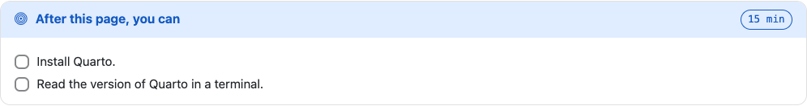{.lightbox group="workshop-blocks" width="996" height="132" loading="lazy" fig-alt="An objectives block on a web page: a blue header with a target icon, the title After this page, you can, a 15 min badge, and two items with a box to tick."}

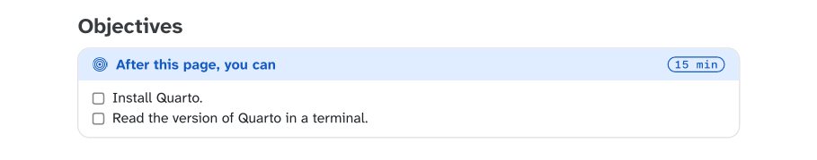{.lightbox group="workshop-blocks" width="909" height="178" loading="lazy" fig-alt="An objectives block in a PDF under the heading Objectives: a blue header with the title and the 15 min badge, and two items with an empty box."}

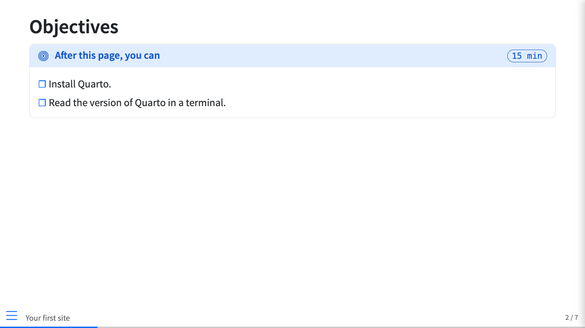{.lightbox group="workshop-blocks" width="1280" height="720" loading="lazy" fig-alt="An objectives slide with the same blue block, the two items with an empty box, and the deck footer."}

:::

**Exercise**

::: {layout-ncol=3}

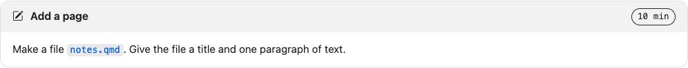{.lightbox group="workshop-blocks" width="996" height="98" loading="lazy" fig-alt="An exercise block on a web page: a grey header with a pencil icon, the title Add a page, a 10 min badge, and two sentences of instructions."}

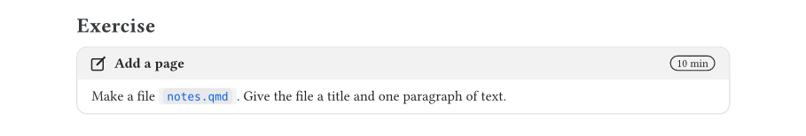{.lightbox group="workshop-blocks" width="909" height="154" loading="lazy" fig-alt="An exercise block in a PDF under the heading Exercise: a grey header with the title Add a page and the 10 min badge, and the instructions."}

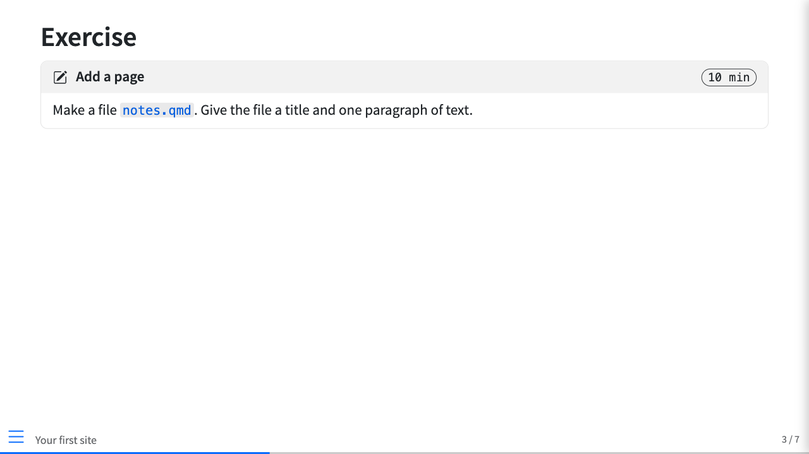{.lightbox group="workshop-blocks" width="1280" height="720" loading="lazy" fig-alt="An exercise slide with the same grey block, the title Add a page, the 10 min badge, and the instructions."}

:::

**Answer**

::: {layout-ncol=3}

{.lightbox group="workshop-blocks" width="996" height="47" loading="lazy" fig-alt="A closed solution on a web page: one line with an arrow and the summary Solution, in a dashed frame."}

{.lightbox group="workshop-blocks" width="909" height="126" loading="lazy" fig-alt="The solution at the end of a PDF: the heading Solutions, the heading Solution 1: Solution, and the text of the solution."}

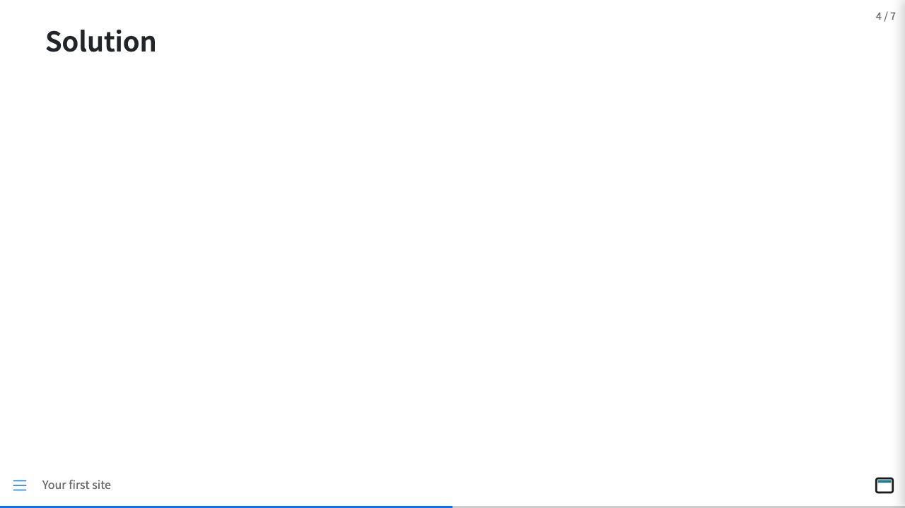{.lightbox group="workshop-blocks" width="1280" height="720" loading="lazy" fig-alt="A solution slide that shows only its heading, because the veil hides the solution when the deck opens."}

:::

**Terminal**

::: {layout-ncol=3}

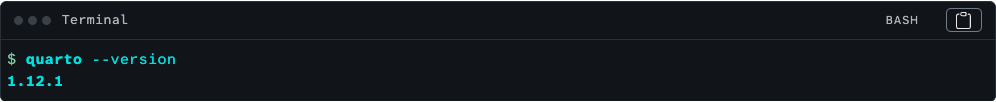{.lightbox group="workshop-blocks" width="996" height="102" loading="lazy" fig-alt="A terminal block on a web page: a dark window with three grey dots, the label Terminal, a copy button, a command after a dollar prompt, and its output."}

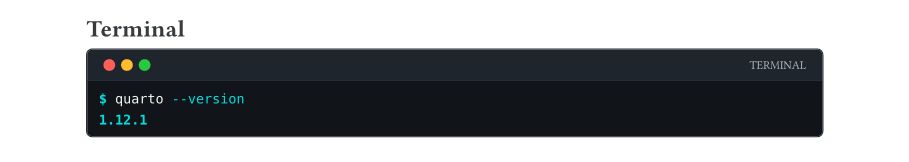{.lightbox group="workshop-blocks" width="909" height="162" loading="lazy" fig-alt="A terminal block in a PDF: a dark window with three coloured dots, the label Terminal, a command after a dollar prompt, and its output."}

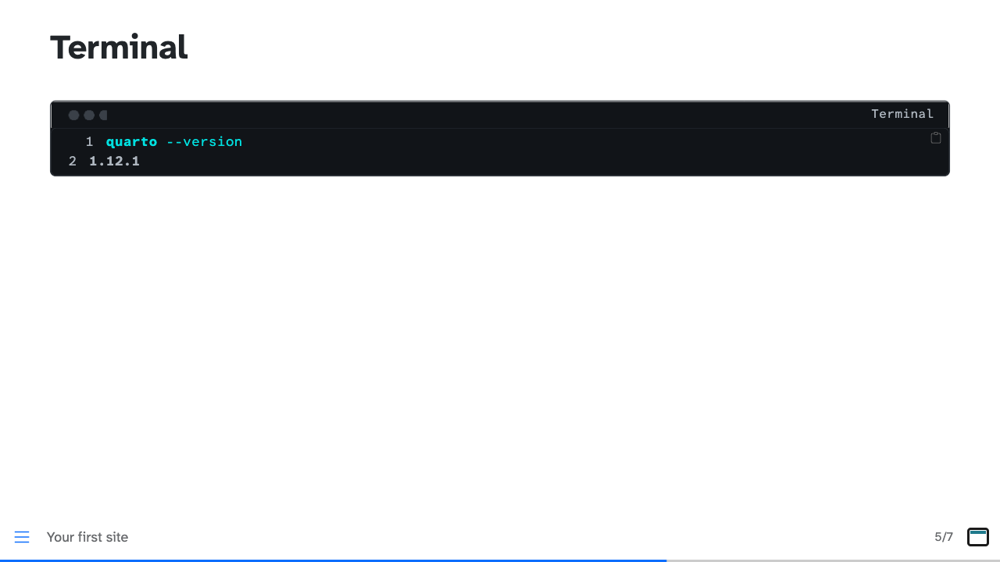{.lightbox group="workshop-blocks" width="1280" height="720" loading="lazy" fig-alt="A terminal slide with the dark window, the command after a dollar prompt, and its output."}

:::

**Prerequisites**

::: {layout-ncol=3}

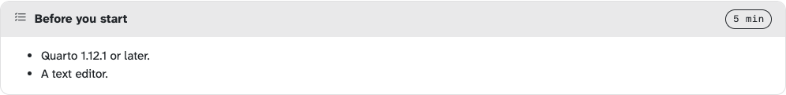{.lightbox group="workshop-blocks" width="996" height="121" loading="lazy" fig-alt="A prerequisites block on a web page: a grey header with a list icon, the title Before you start, a 5 min badge, and two items."}

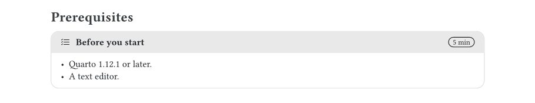{.lightbox group="workshop-blocks" width="909" height="175" loading="lazy" fig-alt="A prerequisites block in a PDF under the heading Prerequisites: a grey header with the title Before you start and the 5 min badge, and two items."}

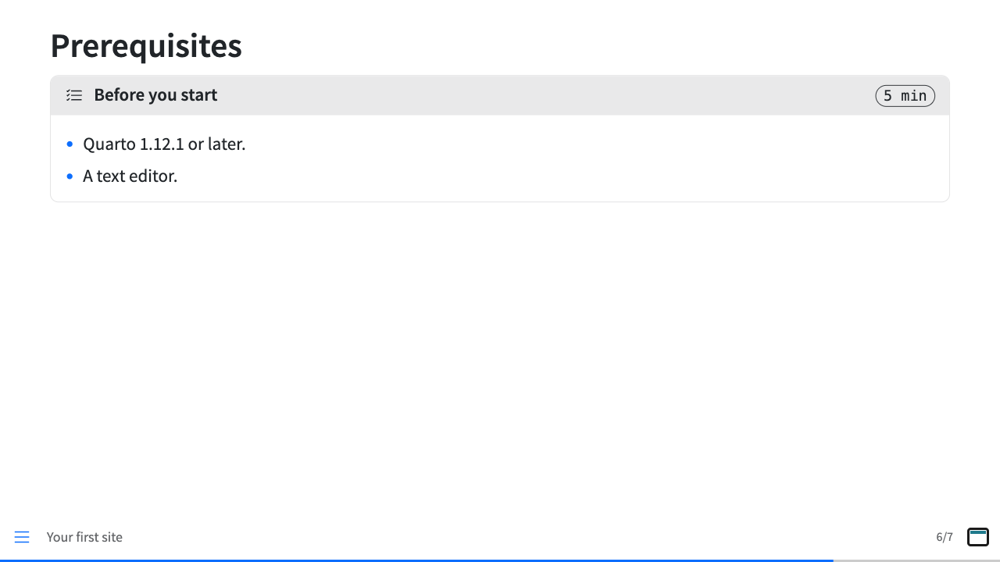{.lightbox group="workshop-blocks" width="1280" height="720" loading="lazy" fig-alt="A prerequisites slide with the same block, the title Before you start, the 5 min badge, and two items."}

:::

**Checkpoint**

::: {layout-ncol=3}

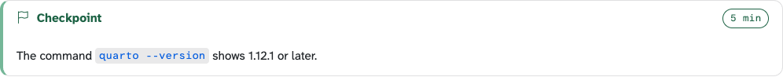{.lightbox group="workshop-blocks" width="996" height="99" loading="lazy" fig-alt="A checkpoint block on a web page: a green bar on the left, a flag icon, the title Checkpoint, a 5 min badge, and one sentence."}

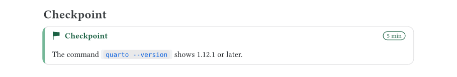{.lightbox group="workshop-blocks" width="909" height="154" loading="lazy" fig-alt="A checkpoint block in a PDF under the heading Checkpoint: a green bar on the left, the title Checkpoint, the 5 min badge, and one sentence."}

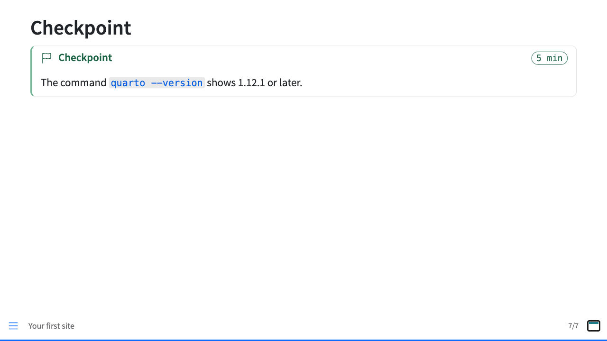{.lightbox group="workshop-blocks" width="1280" height="720" loading="lazy" fig-alt="A checkpoint slide with the same green block, the title Checkpoint, the 5 min badge, and one sentence."}

:::

## Workshop extras

These features work in both modes, except the motif, which shows in workshop mode only.
Each one works on the web page, in the PDF, and in the deck.

### Authors

The title block of a page, the PDF, and the title slide of a deck show each author of the `author` list in the same way, in both modes.
Atelier reads only the native Quarto author keys.

| Field | What it shows |
| --- | --- |
| `name` | The name, linked when `url` is set. |
| `photo`, `photo-alt` | A round photo before the name. |
| `degrees` | The degrees after the name, muted and in italics. |
| `orcid` | An ORCID badge after the name, linked to the profile. |
| `email` | The address as visible text, linked with `mailto:`. |
| `affiliations` | The affiliations under the author, with no superscript numbers. |
| `attributes` | The words Corresponding author, Equal contribution, and Deceased after the name, for `corresponding`, `equal-contributor`, and `deceased` set to `true`. |
| `note` | The note as visible text with the author. |

The title slide of a deck leaves out the note, the DOI, the keywords, and the abstract.

```{.yaml filename="workshop/setup/index.qmd"}
author:
  - name: Ana Diaz
    photo: ana.png
    photo-alt: "Ana Diaz, smiling, in front of a window"
    degrees:
      - PhD
    affiliations:
      - name: Example University
```

The `photo` path is relative to the document.
A path that starts with `/` is relative to the project root, so an author list in `_quarto.yml` works on nested pages.
The photo can be an SVG, PNG, JPG, GIF, or WebP file.
If you write no `photo-alt`, the photo is decorative, because the name is next to it.
If the file is missing or has the wrong type, Atelier logs a warning that names the file and shows no photo.

`extensions.atelier.speakers` no longer exists.
Move each photo to the `photo` key of its author.

These pictures show an author with a photo in each format.

::: {layout-ncol=3}

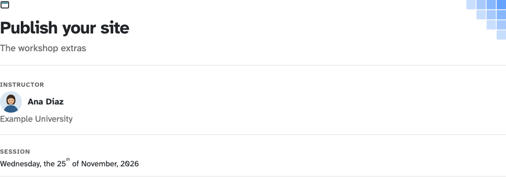{.lightbox group="workshop-speakers" width="996" height="295" loading="lazy" fig-alt="The title block of a web page: the title, the subtitle, a round photo next to the name Ana Diaz under the label Instructor, the affiliation, and the session date."}

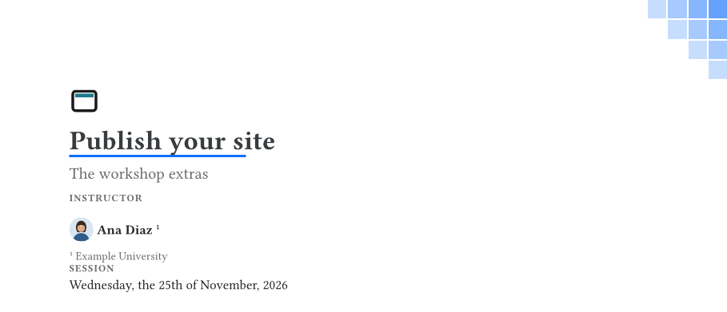{.lightbox group="workshop-speakers" width="909" height="333" loading="lazy" fig-alt="The title block of a PDF: the title with a blue rule, the subtitle, a round photo next to the name Ana Diaz under the label Instructor, the affiliation, the session date, and the motif in the top right corner."}

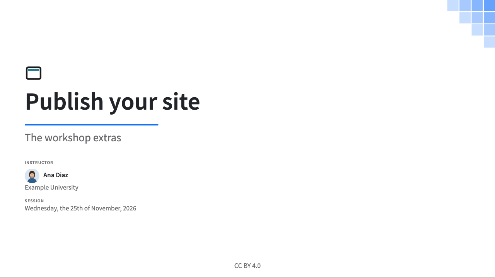{.lightbox group="workshop-speakers" width="1280" height="720" loading="lazy" fig-alt="The title slide of a deck: the title, the subtitle, a round photo next to the name Ana Diaz and the affiliation, the date, and the motif in the top right corner."}

:::

### Closing

`extensions.atelier.closing` ends a page, a handout, or a deck with a thank-you, your own text, links, the copyright, and the licence.
Set it to `true`, or to a map with these keys:

| Key         | Effect                                                                                       |
| ----------- | -------------------------------------------------------------------------------------------- |
| `title`     | The heading. The default is "Thank you".                                                     |
| `text`      | Markdown text that shows after the heading.                                                  |
| `file`      | The path of a Markdown file, from the folder of the page. A path that starts with `/` is an absolute path. Its text shows after the heading. |
| `links`     | A list of links, for example the contact page of the workshop.                               |
| `copyright` | `false` hides the copyright line. The default is `true`.                                     |
| `licence`   | `false` hides the licence line. The default is `true`.                                       |

: Keys of `extensions.atelier.closing`. {.striped .hover tbl-colwidths="[20,80]"}

```{.yaml filename="workshop/publish/index.qmd"}
extensions:
  atelier:
    closing:
      text: "Send us your questions before the next session."
      links:
        - "[Ask a question](https://github.com/owner/project/discussions)"
copyright:
  holder: "Riverlab"
  year: 2026
license: "CC BY 4.0"
```

The closing shows its parts in this order: the heading, the text, the links, the copyright, and the licence.
The copyright line comes from the Quarto `copyright`: a text, its `statement`, or "© `year` `holder`".
The licence line comes from the Quarto `license`: a text, its `text`, or its `type`.
The PDF footer shows the copyright and the licence on every page, also when the closing hides them.

Set `text` or `file`, not both.
The build stops when you set both, when the file does not exist, or when `copyright` or `licence` is not `true` or `false`.
Quarto shortcodes in `text` and in the file do not expand.

Put `closing` in the front matter of the one page that ends the workshop.
Do not set it in `_quarto.yml`.
There it reaches every page, and each page repeats the closing and the CRediT table.
A deck that cites sources shows a references slide before the closing slide.

These pictures show the closing in each format.
The PDF and the deck also show the CRediT table.

::: {layout-ncol=3}

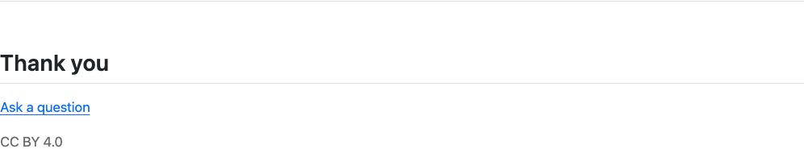{.lightbox group="workshop-closing" width="996" height="190" loading="lazy" fig-alt="The closing at the end of a web page: the heading Thank you, the link Ask a question, and the licence CC BY 4.0."}

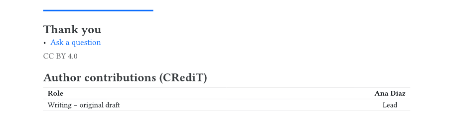{.lightbox group="workshop-closing" width="909" height="251" loading="lazy" fig-alt="The end of a PDF: the table Author contributions (CRediT), a blue rule, the heading Thank you, the link Ask a question, and the licence CC BY 4.0."}

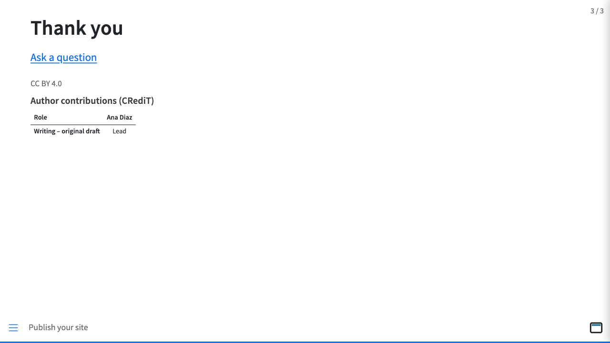{.lightbox group="workshop-closing" width="1280" height="720" loading="lazy" fig-alt="The closing slide of a deck: the heading Thank you, the link Ask a question, the licence CC BY 4.0, and a small CRediT table."}

:::

### CRediT table

The `roles` field of an author gives the contribution roles, with the CRediT terms of Quarto.
A role is a term, such as `writing`, or a term and its degree, such as `writing: lead`.
Atelier shows the roles as a table, with a row for each role and a column for each author.
A cell shows "Lead", "Equal", "Supporting", or "Contributed", from the degree of the role.
A role with no degree shows "Contributed".

```{.yaml filename="index.qmd"}
author:
  - name: Ana Diaz
    roles:
      - writing: lead
```

The PDF and the deck always show the table, at the end and on the closing slide.
A web page shows it only where `closing` is set.
A page with no roles shows no table.

On a web page, the table comes before the closing.
The [Closing](#closing) pictures show the table in the PDF and in the deck.

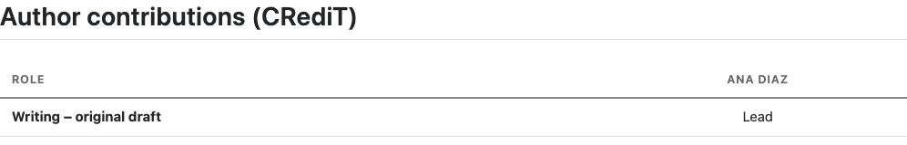{.lightbox group="workshop-credit" width="996" height="160" loading="lazy" fig-alt="The table Author contributions (CRediT) on a web page: a column Role and a column Ana Diaz, with the row Writing, original draft, and the value Lead."}

### Motifs

A motif is a decorative shape on the title block, the title slide, and the section slides.
Each preset has its own motif:

| Preset     | Motif       |
| ---------- | ----------- |
| `default`  | `steps`     |
| `quarto`   | `quadrants` |
| `terminal` | `dots`      |

: The motif of each preset. {.striped .hover tbl-colwidths="[30,70]"}

The motif takes its colour from the palette of the preset, and assistive technology skips it.
You cannot choose another motif.
The [Presets](gallery.qmd#presets) part of the gallery shows the motif of each preset.

## Title block labels

In workshop mode, the title block shows "Instructor" (or "Instructors"), "Session", and "Materials updated" in place of the Quarto labels.
To change this text for the whole site, set the `atelier-workshop-*` keys in `language`:

```{.yaml filename="_quarto.yml"}
language:
  atelier-workshop-author-single: Trainer
  atelier-workshop-author-plural: Trainers
  atelier-workshop-published: Date
  atelier-workshop-modified: Last change
```

To change one label on one page, set `author-title`, `published-title`, or `modified-title` in the front matter of the page.

The [Your first site](demos/workshop-sidebar/workshop/first-site/index.html) page of the demo shows the "Instructors" label.
The [Reference](reference.qmd#language-keys) lists the `language` keys of Atelier, which change the text of the workshop chrome.

## Progress

The browser keeps the progress of the reader in `localStorage`.
The progress holds the pages that the reader opened, the headings that the reader read, and the objectives that the reader ticked.
The key is `atelier:<site path>:<sidebar id>`.
In the live demo, the key is `atelier:/quarto-atelier/demos/workshop-sidebar/:workshop`.

Atelier has no control to reset the progress.
To start again, the reader removes the site data in the browser settings.
If the browser does not let the page store data, the progress stays in memory until the page closes.
If the workshop sidebar has no `id`, Atelier logs a warning, and the progress also stays in memory only.

## Limits

- Atelier does not resolve `auto` or glob entries in the sidebar `contents`, so their pages are not part of the course.
  List each page by its path.
- A `.ipynb` page has no duration.
  Atelier reads durations from `.qmd`, `.md`, and `.Rmd` pages only.
- If no sidebar of `extensions.atelier.sidebars` lists a workshop page, the page shows the plain sidebar, with no workshop bar, timer, or progress.
  Atelier logs no warning for this page.
- If `extensions.atelier.sidebars` lists no sidebar, Atelier logs a warning for each page in workshop mode.
- The anchor and the alias of a sidebar must be in the same YAML file.
- There is no control to reset the progress.
